# Aynı Zamanda

**Aynı sırada, dünyanın başka yerlerinde ne oluyordu?**

Bir bölgenin tarihini tek başına okumak, olayları birbirinden kopuk bir listeye çevirir. *Aynı Zamanda*, bu
soruyu kolay yanıtlamak için tasarlanmış, zamanı ön plana alan etkileşimli bir tarih haritasıdır. Kullanıcı iki şey
seçer: bir **zaman aralığı** (tek yıl, 5 yıl, 100 yıl; kararı kullanıcı verir) ve haritada bir **yer**.

- **Harita zamana bağlıdır:** o dönemin siyasi sınırlarını ve dünyanın dört bir yanından bir olay seçkisini gösterir.
  Haritada **tek anlatıcı** vardır: hiçbir şey seçili değilken dünya olayları (önemli olanlar) haritadadır; bir yer seçilince
  onlar haritadan çekilir (çizelgede kalırlar, seçim kalkınca dönerler) ve yer kendi kartı, vurgusu ve çizelgesiyle anlatır;
  yapay zekâ konuşurken harita onundur.
- **Zaman çizelgesi yere bağlıdır:** seçilen yerle doğrudan ilgili olayları, dünya tarihinde önemsiz olsalar bile, gösterir;
  yalnızca **seçili aralığı** gösterir (aralığın öncesi ve sonrası yoktur).

Bu ilk prototip, görsel dili ve etkileşimi oturtmak içindir; yayındaki dönem **1800–2000**'dir ve açılış ekranı **İkinci Dünya
Savaşı** yıllarındadır (1939–1945). Olay verisi bilerek küçüktür (74 olay: iki yüzyıla yayılmış birkaç dönüm noktası ve savaş için
yoğun bir küme). Önceki dönem (1400–1600) verisiyle ve hattıyla birlikte depoda durur, ama yayın dışıdır
([`data/README.md`](data/README.md)).

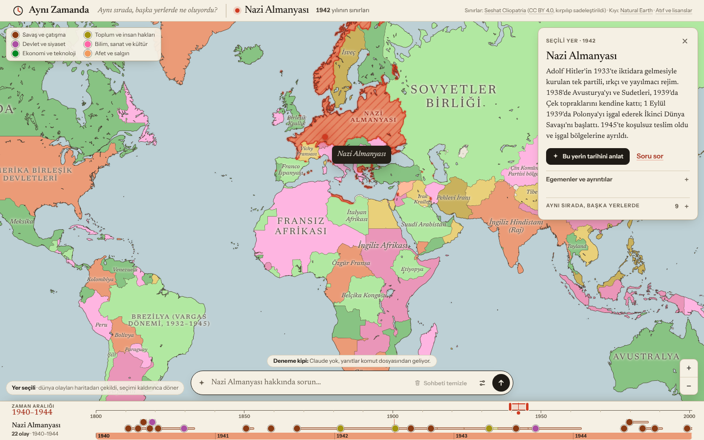

| Sovyetler Birliği seçili, aynı harita | Aralık 1938–1942 | Olay ayrıntısı |
|---|---|---|
| 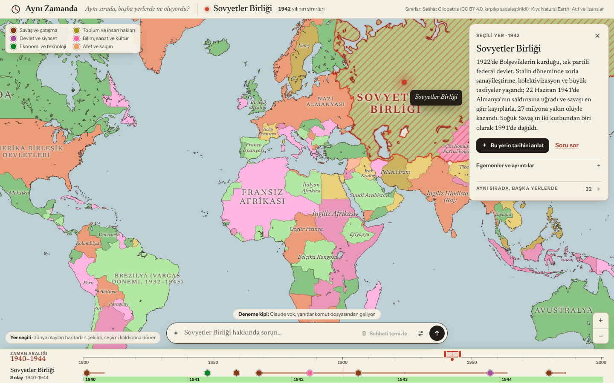 | 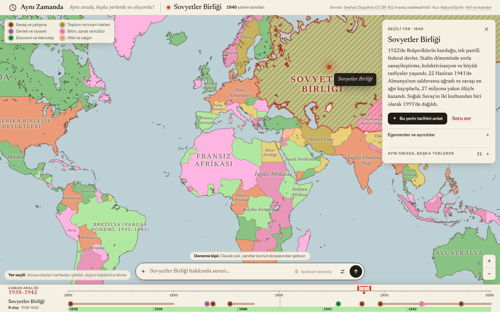 | 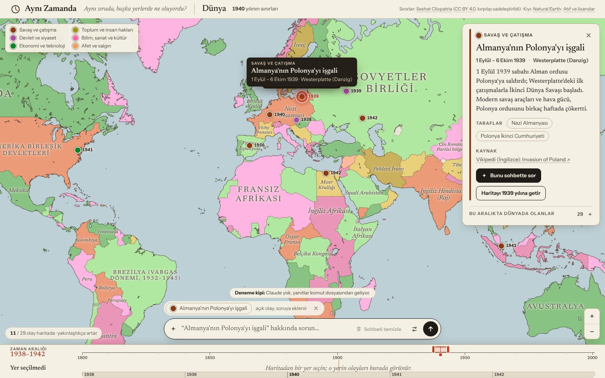 |

Çizelgeden görünüm dışındaki bir olay (Stalingrad, 1942) seçilince harita yumuşakça, yalnızca gerektiği kadar uzaklaşır:

| Önce: Çin'e yakınlaşılmış | Sonra: Volga görünür, işaretçi vurgulu | Olay kapatılınca |
|---|---|---|
| 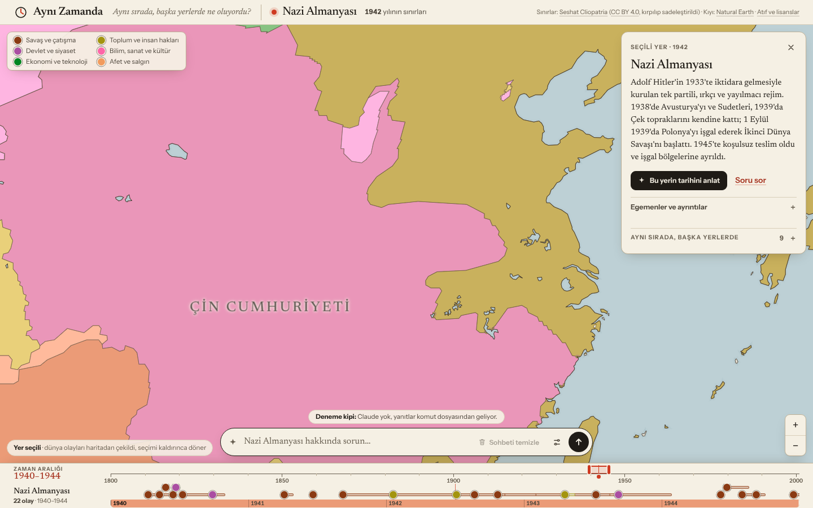 | 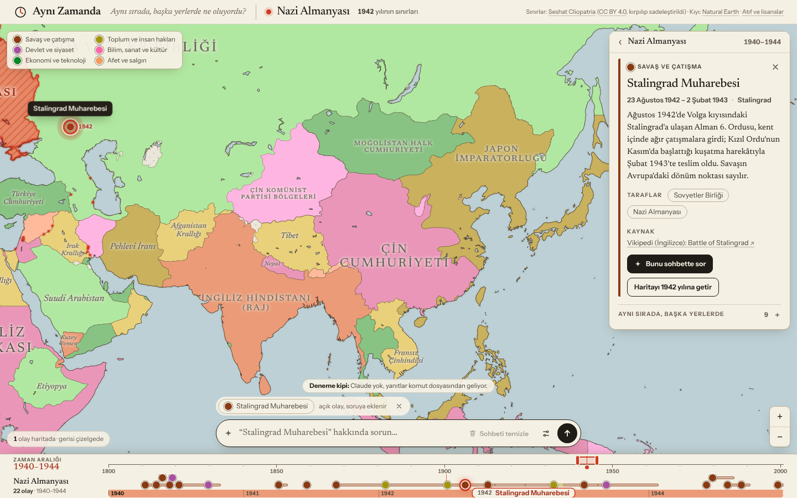 | 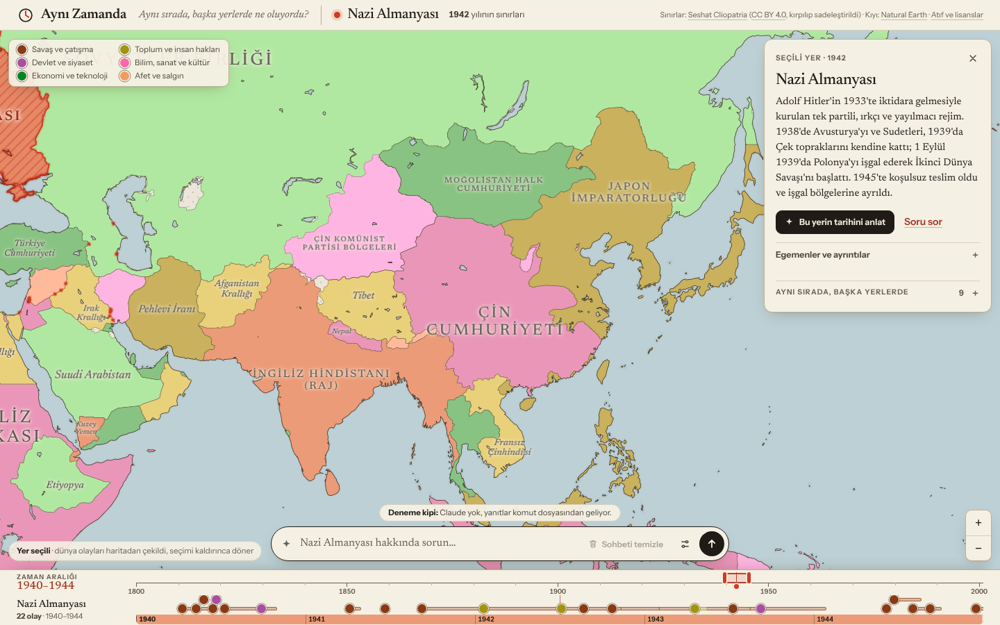 |

## Çalıştırma

En kolay yol **tek dosya sürümüdür**: sunucu da, kurulum da gerekmez.

```bash
npm install
npm run build:standalone   # → dist-standalone/ayni-zamanda.html (~7,4 MB)
```

`ayni-zamanda.html` dosyasını tarayıcıda açmak (çift tıklamak) yeterlidir. Betik, stil, yazı tipleri ve tüm veri dosyanın
içindedir; hiçbir ağ isteği yapmaz, çevrimdışı çalışır ve her statik barındırmaya tek dosya olarak yüklenebilir.
(`ayni-zamanda.fragment.html`, kendi `<html>` kabuğunu ekleyen barındırıcılar için aynı sayfanın gövdesidir. Bu sürümde
"Atıf ve lisanslar" bağlantısı, dosyanın yanında NOTICE.txt olmadığı için depodaki dosyaya gider.)

Geliştirme için:

```bash
npm install
npm run dev          # http://127.0.0.1:5173
npm run build && npm run preview
npm test             # birim testleri + veri doğrulaması
npm run e2e          # gerçek tarayıcıda kabul senaryosu (aşağıya bakın)
npm run e2e:ai       # okuma arkadaşı (sohbet) için aynısı, komut dosyalı modelle
npm run data:validate
npm run data:period -- --list        # yayındaki ve arşivdeki dönemler (bir dönemi yayına almak: data/README.md)
```

Gerekenler: Node 20.19+ (22 önerilir). Veri hattını yeniden çalıştırmak için ayrıca Python 3 ve `shapely` gerekir;
uygulamanın kendisi Python'a ihtiyaç duymaz, çünkü üretilen veri depoda durur.

## Kullanım

| Ne yapmak istiyorsunuz | Nasıl |
|---|---|
| Zaman aralığını seçmek | Alttaki cetvelde aralık çubuğunu sürükleyin; kenarlarından sürükleyerek uzunluğunu ayarlayın; boş yere tıklarsanız aralık oraya taşınır. Başka denetim yoktur (yıl kutusu, hazır süre düğmesi yok). Klavyeyle: çubukta `←/→` 1 yıl, `Shift` ile 10 yıl, `Home/End` uçlara |
| Haritada hangi yılın sınırlarının çizildiğini seçmek | Aralığın içindeki küçük işareti (çizgi + nokta) sürükleyin (varsayılan: aralığın ortası). Seçili yıl, haritanın üstündeki başlıkta "… yılının sınırları" notunda yazar |
| Bir yeri seçmek | Haritada bir devletin üzerine tıklayın. Dünya olayları haritadan çekilir (sol altta "Yer seçili · dünya olayları haritadan çekildi, seçimi kaldırınca döner" yazar). **Harita yerinden oynamaz**: yalnızca sürükleme, tekerlek, çimdik ve `+/−` düğmeleri haritayı hareket ettirir (istisnalar aşağıda: görünüm dışındaki bir olayı açmak; bir yanıt ekrandayken, siz açık tutarsanız, *Harita takibi*). Sağdaki küçük bilgi kartı haritanın bir köşesini örter: ✕ ile kapatın |
| Bir olayı okumak | Haritadaki işaretçiye, çizelgedeki noktaya ya da kartın *Aynı sırada, başka yerlerde* bölümüne tıklayın (bir yer seçiliyken ya da bir yanıt ekrandayken dünya olayları haritadan çekilir: çizelgeden tıklayın, işaretçisi haritaya gelir). Çizelgede olay adları kalıcı yazılmaz: noktanın üstüne gelince (dokunmatikte dokununca) adı görünür; açık olayın adı noktasının yanında kalır. Klavyeyle: `Tab` ile işaretçi grubuna girin, ok tuşlarıyla işaretçiler arasında gezinin, `Enter` ile açın (odak olay kartına gider) |
| Olaydan yer görünümüne dönmek | Kartın üstündeki tek satırlık yer başlığına tıklayın (ad + aralık), olay kartında ✕'e basın ya da `Esc` |
| Seçimi kaldırmak | Kartta ✕ ya da `Esc` (önce açık olayı kapatır; ekranda yanıt yoksa ikincisi yer seçimini kaldırır) |
| Bir şey sormak | Alttaki soru kutusuna yazın (`Enter`); kartta *Bu yerin tarihini anlat* / *Soru sor* da aynı kutuyu kullanır. Kart kenara çekilir, yanıt haritanın üstünde görünür |
| Bir anlatımı izlemek | **İzle**: `←` / `→` (`Home` / `End`) ya da düğmeler; *Oynat* ve hız seçici (Yavaş / Normal / Hızlı) kendiliğinden ilerletir; zaman cetvelindeki numaralı noktalar o adıma götürür. Altyazıdaki altı çizili olay adları tıklanabilir: çizelgedeki olaya tıklamakla aynı şeyi yapar |
| Sohbeti sıfırlamak | Soru kutusundaki **Sohbeti temizle** (her zaman görünür): konuşma silinir, model de onu bir daha görmez |
| Metni okumak | *Metni oku* (ya da soru kutusundaki metin düğmesi): yan panel; ⤢ tam ekran (köşede küçük harita); *İzle* geri döner. Adım her geçişte korunur; `Esc` adım adım kapatır |

**Açık olay her zaman haritadadır.** Çizelgeden ya da listeden bir olay açtığınızda işaretçisi, yakınlaştırma bütçesi veya
eleme yüzünden normalde çizilmeyecek olsa bile, çizilir ve belirgin biçimde vurgulanır (kalın vermilyon halka, ışıma,
adı yanında). Yeri o anki görünümün dışındaysa harita, yeri görünene kadar **yalnızca uzaklaşır** (kaydırmak yerine
uzaklaşmak tercih edilir; önceki görünüm yeni görünümün içinde kalır) ve bunu sıçramadan, yumuşakça yapar. Zaten görünen
bir olayı açmak (örneğin kendi işaretçisine tıklamak) haritayı hiç oynatmaz.

Adres çubuğu durumu taşır (`#t=1940-1944&p=9.2,48.8&e=stalingrad-1942`), bu yüzden bir görünümü bağlantıyla paylaşabilirsiniz.
Harita kamerası (`v=yakınlaştırma/enlem/boylam`) adrese yalnızca siz haritayı kendiniz oynattıktan sonra yazılır; açılıştaki
otomatik çerçeve herkes için aynıdır ve bağlantıya girmez. Bozuk ya da yarım bir bağlantı (ör. `p=9.2,`) yok sayılır;
uygulamayı çökertmez. Fare olan cihazlarda tekerlek haritayı yakınlaştırır (dar pencerede de); dokunmatik ekranlarda sayfa
kaydırması ile harita hareketi karışmasın diye harita iki parmakla gezilir.

## Okuma arkadaşı: haritayla birlikte okuyan sohbet

Düzen **harita öncelikli**dir: harita ekranın neredeyse tamamıdır (1440×900'de %86); üstte tek ince çubuk (ad, yer ve yıl, atıf),
altta ince zaman çizelgesi (≈ 80 px) ve onun hemen üstünde **soru kutusu** durur. Sağdaki **bilgi kartı** küçüktür (≈ 330 px), ✕ ile
kapanır ve okur bir şey sorunca **kendiliğinden kenara çekilir**: yalnızca yerin adını taşıyan küçük bir sekme kalır (yer seçili kalır,
soru onunla ilgilidir; sekme kartı geri getirir; yanıt kapanınca ya da başka bir yer seçilince kart kendiliğinden döner).
Şimdiye kadarki uygulama sohbetin **bağlam seçicisidir**: seçili yer, zaman aralığı ve açık olay modele kendiliğinden gider; harita ise
model anlatırken üzerine çizdiği şeydir. Harita yine yalnızca zamana bağlıdır (sınırlar ve haritanın tuttuğu
olay kümesi); hangi olayların *çizildiğini* anlatıcı belirler (aşağıda: haritada tek anlatıcı). Zaman çizelgesi seçili yere ve
yalnızca seçili aralığa bağlıdır.

| Harita öncelikli düzen | İzle: sabit yerde altyazı, adım adım |
|---|---|
| 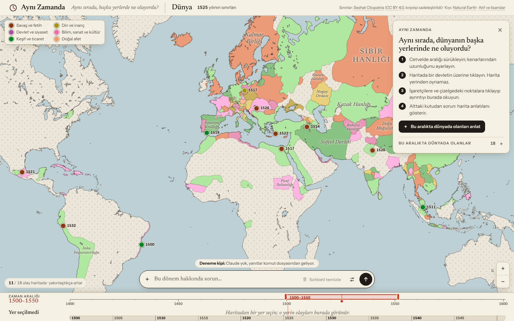 | 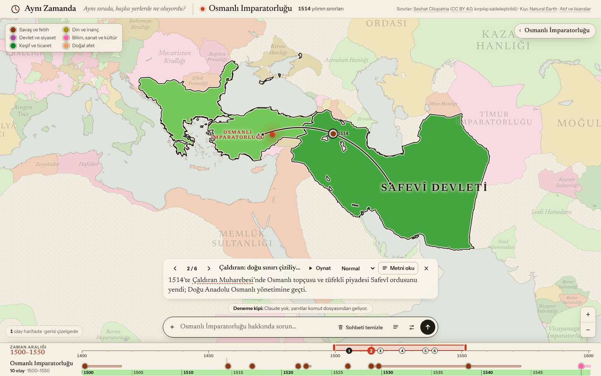 |

| Oku: yan panel (1. adım) | Oku: tam ekran, köşede küçük harita (1. adım) |
|---|---|
| 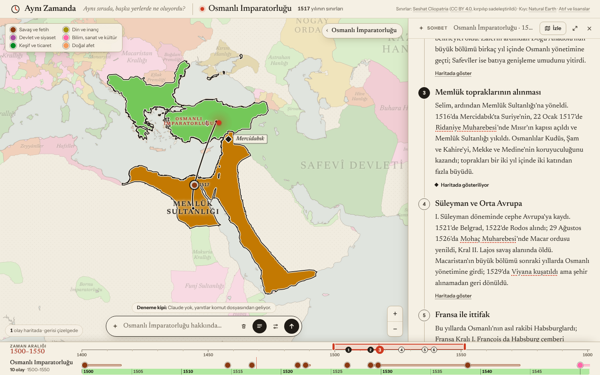 | 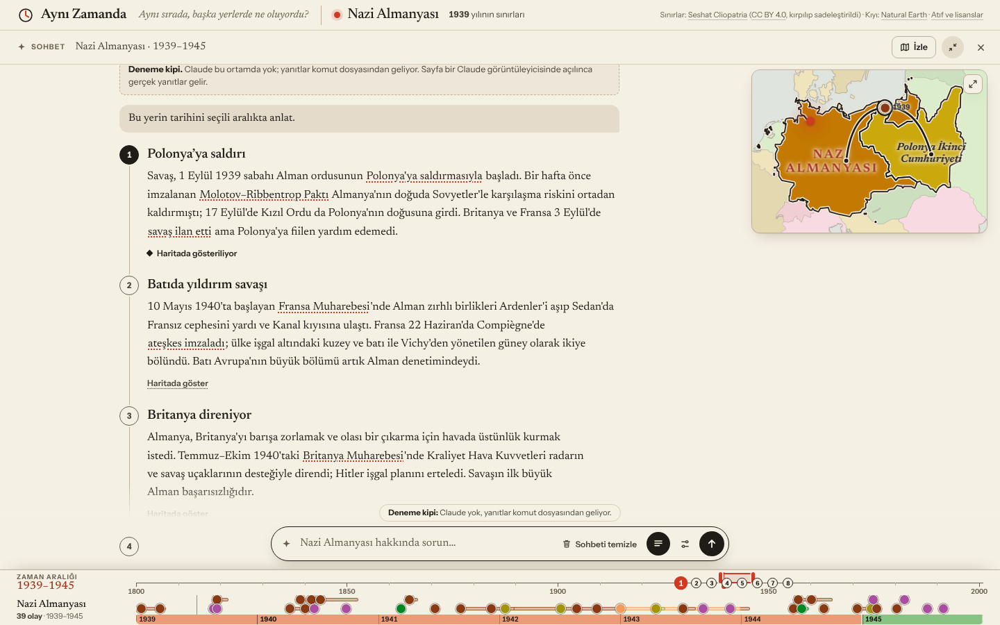 |

| Tek adımlı yanıt: altyazı ve «Devamını oku» (Stalingrad) | Düz metin yanıt: altyazı ilk cümle, geri kalanı Oku'da | Zaman çizelgesi ilerleme çubuğu |
|---|---|---|
| 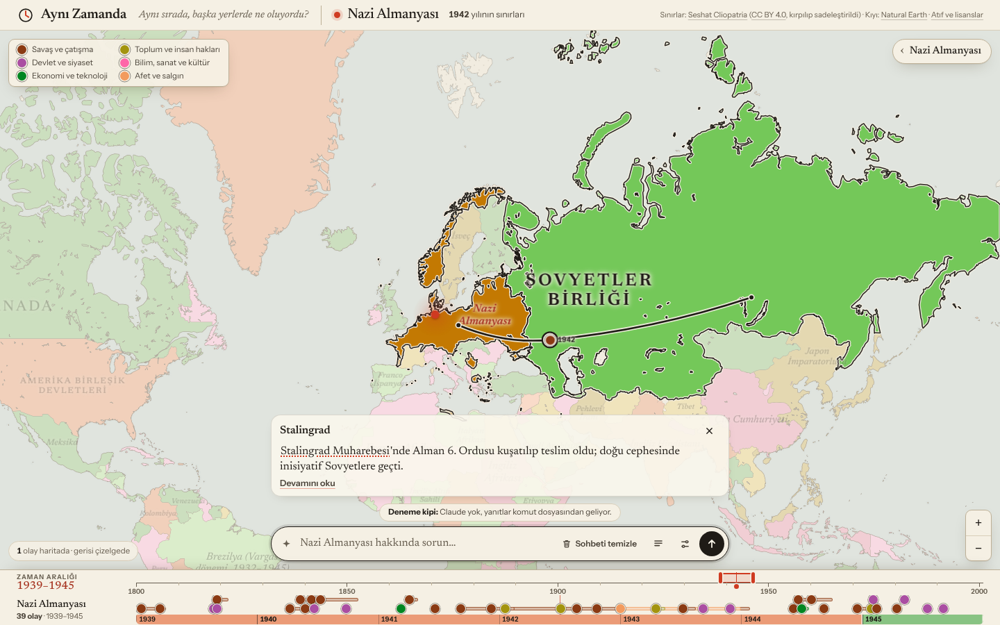 | 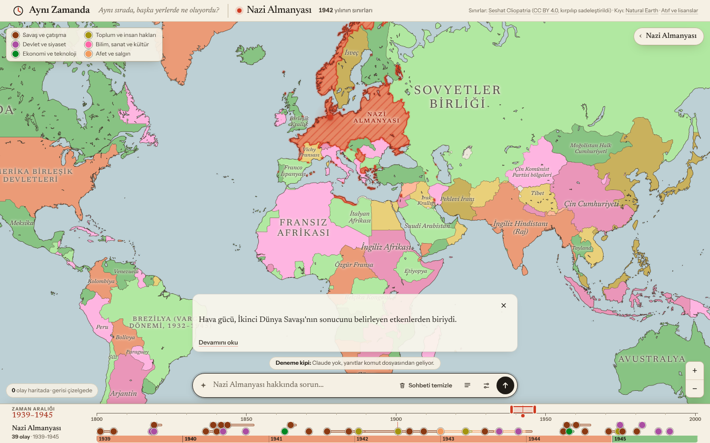 | 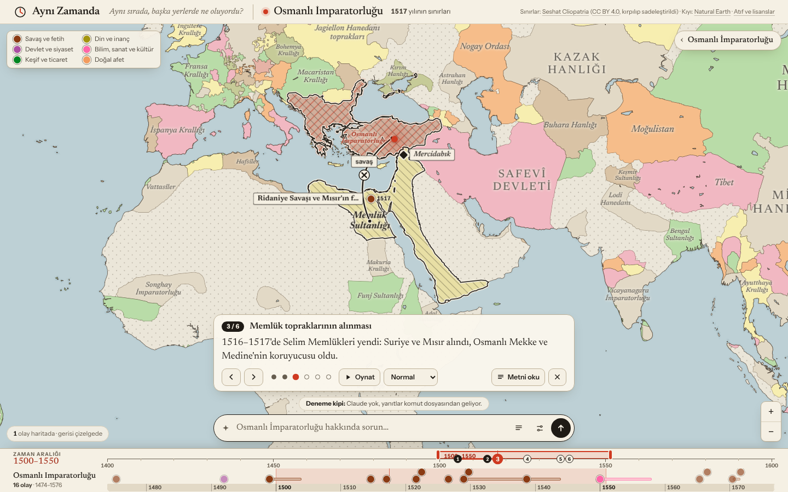 |

**Bir anlatımı iki biçimde izlemek: İzle ve Oku.** Çok adımlı bir anlatım iki görünümde izlenir; ikisi de **aynı adımı** paylaşır.

- **İzle** (varsayılan): harita tam ekran kalır, anlatım adım adım ilerler. Her adımın **kısa altyazısı** (bir iki cümle) haritanın üstünde,
  soru kutusunun hemen üzerindeki sabit bir yerde durur, altyazı gibi; kutunun yeri adımdan adıma değişmez. Adımlar **← / →** (ve
  `Home` / `End`), *önceki* / *sonraki* düğmeleri, adım noktaları ya da zaman çizelgesindeki noktalarla gezilir. **Otomatik oynatma isteğe
  bağlıdır** (kendiliğinden başlamaz) ve hızı seçilir: *Yavaş / Normal / Hızlı*. Bir adım, altyazısının okunma süresi kadar kalır
  (2,2 sn + sözcük başına 0,36 sn, en az 4,5 en çok 16 sn; hıza bölünür: 0,65 / 1 / 1,8). Elle adım değiştirmek, görünümü değiştirmek ya da
  duraklat oynatmayı durdurur; son adımın altyazısı da okunduktan sonra oynatma biter (başa dönmez). Oklar metin kutusunda, ayar
  listesinde ve kaydırıcılarda kendi işlerini yapar; harita odaktayken de haritayı kaydırmaz.
- **Oku**: tam metin. **Kapalı**, **yan panel** (≈ 460 px, haritanın üstünde bir katman: harita yine tam ekrandır, çizim panelin
  altında kalmayacak biçimde görünür kılınır) ya da **tam ekran** olur. Tam ekranda harita sağ üst köşede **küçük bir pencere** olur
  (≈ 340×236) ve **o anki adımı** gösterir; pencerede yalnızca çizimin kendisi vardır (devlet adları, çizgiler, işaretler; ad
  etiketleri metnin yanında olduğu için yazılmaz), köşedeki düğmeyle harita yeniden büyür. Metni kaydırmak okuma çizgisindeki adımı etkin
  yapar ve harita (ya da küçük pencere) ona geçer. Telefonda metin her zaman tam ekrandır ve küçük harita başlığın altındadır.
- **Geçişte adım korunur.** İzle'de 3. adımdayken *Metni oku*: metin açılır, 3. adım okuma konumundadır ve etkindir; geri dönünce
  altyazı yine 3. adımındır. Yan panel ↔ tam ekran geçişinde de etkin adım okuma konumunda kalır (metin yeni genişlikte yeniden
  dizilir). Okuyucu en son kullanılan kipte açılır. `Esc` önce açık olay kartını, sonra tam ekranı yan panele, sonra metni, sonra
  ekrandaki yanıtı, en sonda yer seçimini kapatır.
- **Okurken sorulan soru haritayı arka planda günceller:** yanıt metne eklenir, okuyucu açık kalır ve arkadaki harita (ya da küçük pencere)
  yeni yanıtın sahnesine geçer.
- **Zaman cetveli ilerleme çubuğudur** (adımlı bir anlatım ekrandayken): adımlar, sahnelerinin yılında numaralı noktalardır, görülenler
  dolu, etkin olan işaretli ve ilkinden ona bir çizgi uzanır; bir noktaya tıklamak o adıma götürür ve okurun aralığına ya da imlecine
  dokunmaz. Yılsız adımlar çubukta yoktur. **Noktalar birbirine değmez**: yan yana düşenler, yıllarının çevresinde en az harekete
  mal olacak biçimde (en küçük kareler; `src/domain/spread.ts`) en az 22 px arayla açılır; noktalar fırçanın satırını kullandığı için
  fırçanın kendi aralık yazısı onlar varken gizlenir (aralık, cetvelin yanındaki büyük yazıda durur). Adım noktaları ve zaman cetveli
  dışında adım gezinmesi İzle'nin düğmelerindedir.

**Her yanıtın bir altyazısı ve bir tam metni vardır.** Model biçim seçmez: her yanıt bir **anlatımdır** ve her adımın bir **başlığı**,
bir **kısa altyazısı** (bir iki cümle) ve bir **tam metni** vardır. Adımlar **sahnedir**: her adım kendi harita durumunu bildirir.
Yanıtlar yalnızca adım sayısıyla ayrışır:

- **Çok adımlı** (bir süreç, bir dönem, birbirine bağlı olaylar): İzle'de adım gezintisi (oklar, düğmeler, oynat/hız) ve zaman cetvelinde
  adım noktaları vardır.
- **Tek adımlı** (bir olay, bir kişi, bir kavram, bir neden; yani kısa sorular): **tek sahnelik bir anlatım**dır. İzle'de yalnızca
  altyazı ve altında **Devamını oku** durur (adım sayacı, oklar, oynat/hız ve cetvelde adım noktası yoktur); *Devamını oku* (ya da
  *Metni oku*) aynı yanıtın tam metnini Oku'da açar, kapatınca altyazıya dönülür. Metin altyazıdan fazlasını taşımıyorsa
  (tek kısa cümle) *Devamını oku* da çıkmaz.
- **Güvenlik ağı: düz metin.** Model biçimi hiç izlemez ve yalnızca düz metin yazarsa sayfa metnin **tamamını altyazıya koymaz**: ilk bir
  iki cümleyi (en çok ~220 karakter; tek uzun cümle bir sözcükten, olay adının ortasından değil, kesilir) altyazı yapar, geri kalanı
  Oku'ya bırakır ve altyazının altına *Devamını oku* koyar (`captionFromText`, `hasMore`: `src/ai/narration.ts`).

**İzle, uzun metinler bitmeden başlar.** Model önce, hiç metin yazmadan, adımları ve sahnelerini bildirir; metin sonra akar. Sayfa plan
gelir gelmez İzle'yi başlatır: ilk adımın altyazısı ve haritası hazırdır, "Metin yazılıyor…" yazar; okur o sırada adımlarda gezebilir
(metin gelmemiş adımın okuyucudaki yeri altyazısıyla doludur).

**Nasıl çalışır**

- **Her adım haritanın sahibidir:** etkin adım haritada yalnızca kendi çizimlerini gösterir (devlet vurguları, bağlantılar, olay
  işaretçileri, işaretler, sınır yılı); bir önceki adımın çizimleri gider, geri dönülünce o adımın çizimi aynen gelir. Hiçbir adım ötekinden
  bir şey devralmaz (yıl dahil: yıl istemeyen adımda yıl okurun kendi imlecidir); bu yüzden model her adımda gereken her şeyi kendisi
  bildirir ve `clear` diye bir araç yoktur.
- **Bağlam.** Model her soruyla birlikte seçili yeri (o yıldaki devleti ve aralıktaki egemenlerini), aralığı, haritadaki yılı, açık
  olayı, aralıkta sınır verisinde bulunan devletlerin listesini (kimlik | ad) ve uygulamanın olay kayıtlarını alır. Bağlam bir **yer
  listesidir** ve her yerin kendi aralığı vardır (bugün hepsi seçili aralık; birden çok yer ya da dönem haritaya bir şey
  koymadan, sohbetin kendisinden gelecek: okur sorusunda başka bir yeri ya da dönemi anacak). Sohbet sürerken
  yer ya da aralık değişirse metinde bir **"Bağlam değişti"** ayırıcısı (eski → yeni) çıkar; okur eski konuya dönerse kalkar; model de
  bir sonraki istekte bunu bir cümleyle öğrenir. Yıl imlecini oynatmak ya da bir olay açmak "yeni konu" sayılmaz. Açık olay kartı
  soru kutusunda bağlam olarak görünür ("açık olay, soruya eklenir"); kartta *Bunu sohbette sor* olayı soruya ekler ve kartı kapatır.
- **Model NEYİ gösterir, uygulama NASIL gösterir.** Haritaya çizim yalnızca araç çağrılarıyla olur ve **beş araç** vardır; hiçbiri görünüşle
  ya da kameralı ilgili değildir: `step` (adımı bildirir: numara, başlık, altyazı ve isteğe bağlı `year`), `show_event` (verideki bir
  olayı gösterir), `highlight` (hangi devletlerin öne çıkacağını söyler), `connect` (veride olmayan bir ilişki için savaş / ittifak /
  ticaret / antlaşma çizgisi) ve `mark` (veride olmayan bir yer için koordinat + kısa etiket). `set_year` ve `focus` kalktı: yıl
  `step`'in parametresidir (olay gösteren adımda gerekmez), bölgeyi uygulama kendisi çerçeveler.
  - **Olay-merkezli gösterim.** Anlatılan şey verideki bir olaysa model yalnızca *hangi olay* olduğunu söyler (`show_event`); uygulama onu
    **olayın türüne göre, her seferinde aynı biçimde** çizer (`src/ai/eventKinds.ts`, `src/ai/drawing.ts`): olayın **tarafları** öne çıkar
    ve olayın **kendi işareti** konur. **Savaşta** (`military`) iki taraf arasındaki çizgi, olayın işaretinin üzerinden geçer ve işaret
    kâğıt renkli bir halkanın içinde durur: işaret ile çizgi tek şey okunur, aynı savaş her seferinde aynı görünür. Taraflar `parties`'ten
    gelir: ilk taraf ile ikincisi arasında; ilk ikisi aynı safsa (Dunkirk: Britanya ve Fransa, Almanya'ya karşı; Normandiya
    Çıkarması; Dresden'in bombalanması) olay kaydındaki isteğe bağlı **`versus`** alanı karşı safı söyler (`public/data/schema/events.schema.json`).
    Çizgi, her devletten olaya en yakın ana parçasından çıkar. Olay bir tarafın sonu olduysa (1945 olayları: Nazi Almanyası'nın
    satırları 1944'te biter) adım, o devletin sınırlarının hâlâ olduğu en son yılı (en çok üç yıl önce) gösterir (Berlin Muharebesi ve
    Almanya'nın teslimi 1944 sınırlarıyla görünür); savaş yine çizilir. Savaş olmayan türler (siyaset, ekonomi, toplum, kültür, afet)
    tarafları öne çıkarır ve işaretini koyar. Modelin kendi `connect`'i
    olayın zaten çizilen savaş çizgisiyle aynı iki devleti bağlıyorsa ikinci kez çizilmez.
  - **Spot ışığı.** Bir adımda öne çıkan devletler (modelin `highlight`'ı + gösterilen olayların tarafları + kendi çizgilerinin uçları)
    **dolgun ve canlı** çizilir: kendi renklerinin canlı ikizi (`--vivid-N`; aynı ton, daha koyu ve doygun), kâğıt rengi bir kenar ve mürekkep
    çerçeve; haritanın geri kalanı **soluk**tur (üstüne %62 kâğıt rengi bir örtü; *bulanıklık yok*, yalnızca daha az renk) ve öne
    çıkmayan devlet adları da soluklaşır. Önceki tarama kalktı. Örtü yalnızca bir şey öne çıkarılmışken vardır.
  - **Olay işaretleri metinde.** Altyazıda ve metinde verideki bir olaydan söz edilince model adını `[olay adı](olay:KİMLİK)` biçiminde
    yazar; sayfa onu altı noktalı çizgili bir bağlantıya çevirir (`src/ui/read/segments.ts`). Tıklamak, çizelgedeki olaya tıklamakla
    **aynı şeyi** yapar (olay kartı açılır, görünüm dışındaysa harita yalnızca gerektiği kadar uzaklaşır; ikinci tıklama kapatır).
    Verideki bir olaya çözülmeyen kimlik düz metin kalır; yazılırken yarım kalmış bir bağlantı gösterilmez. Haritadaki olay işaretlerinin
    yanında **ad kutusu yoktur**: ad, işaretin üstüne gelince görünür (açık olayın kendi adı hariç).
  - Modelin yazdığı her başvuru verideki bir şeye çözülmek zorundadır (devlet kimliği ya da adı, olay kimliği ya da adı, haritanın
    içinde bir koordinat, aralığın içinde bir yıl); çözülmeyen çizim **sessizce atlanır** (yalnızca modele "atlandı" denir). Model
    verideki bir olayı `mark` ile çizerse (aynı yer adı ya da olay adı, olayın yerine ≤ 60 km, aralıkta tek eşleşme) sayfa onu olay
    olarak gösterir ve modele bunu söyler.
- **Haritada tek anlatıcı.** Bir anda yalnızca biri anlatır: ekranda bir yanıt varsa yapay zekâ, yoksa ve bir yer seçiliyse yer, ikisi de
  yoksa dünya olayları. Anlatıcı varken **dünya olayları haritadan çekilir** (hepsi yer çizelgesinde ve kartın *Aynı sırada, başka yerlerde* listesinde durur; sol alttaki not "Yer seçili · dünya olayları
  haritadan çekildi, seçimi kaldırınca döner", yapay zekâ anlatırken "N olay haritada · gerisi yanıt kapanınca döner" (yerle birlikte
  "gerisi çizelgede") der). Açık olay her zaman haritadadır; yapay
  zekâ bir olaydan söz ederse onun işareti de gelir. Yanıt kapanınca (✕ ya da `Esc`) çizim kalkar ve seçili yer yoksa olaylar geri gelir.
- **Kamera: Harita takibi.** Açıkken (varsayılan) her adım etkin olduğunda harita o adımın çizimlerini **görünür kılar**: vurgulanan
  devletlerin ana parçaları, bağlantı uçları, işaretler ve olaylar birlikte, gerektiği kadar kayarak *ve* yakınlaşıp uzaklaşarak,
  yumuşakça (0,8–2,4 sn), haritanın üstündeki her şeyin (bilgi kartı, altyazı ya da kısa yanıt, soru kutusu, okuyucu paneli, yakınlaştırma
  düğmeleri) altında kalmadan (`MapView.frameTarget`, `domain/camera.ts`; ekranın dibi daha çok yer ayırabilir, çünkü altyazı ve soru kutusu
  oradadır). Kısa bir yanıt metninin büyüyebileceği yer baştan ayrılır, böylece harita tek kez çerçevelenir. Çizim zaten iyi çerçevedeyse
  harita oynamaz. Hiçbir araç kamerayı oynatmaz; **kamera sayfanın işidir**: her adımda, adımın gösterdiği **her şey** (öne çıkan devletlerin ana parçaları, olay
  işaretleri, savaş çizgisinin uçları, modelin kendi çizgileri ve işaretleri) altyazının ve soru kutusunun (ve ötekilerin) kapladığı yerin
  **üstündeki** görünür alana sığdırılır; `npm run e2e:ai` bunu her adımda ölçer.
  Okurun **küçük** hareketleri takibi kapatmaz: haritanın kısa kenarının üçte birinden az kaydırma, bir kez `+`/`−`. **Önemli** bir harekette
  (üçte bir ya da daha çok kaydırma, ya da `+/−` ile bir buçuk düzeyden çok; hareketler sayfanın bıraktığı kameradan itibaren toplanır)
  haritanın üstünde küçük bir soru çıkar: *Haritayı kendiniz gezdiniz. Adımlar haritayı izlemeyi bıraksın mı?* (*Bıraksın* / *İzlemeye
  devam*), yanında ayarın yeri: **Ayarlar ⚙ → Harita takibi** (tıklanınca soru kutusunun ayarları açılır ve satır işaretlenir). Soru iletişim
  kutusu değildir: odağı çalmaz, haritanın %6'sından azını kaplar, cevaplanmazsa kendiliğinden kalkar (hiçbir şeye karar vermeden) ve
  "İzlemeye devam" denirse o sohbette bir daha sorulmaz. Takibi yalnızca okurun cevabı ya da ayar kapatır; kapalıyken adımlar çizimi
  değiştirir ama haritayı oynatmaz ve soru kutusunun üstünde "Harita takibi kapalı · aç" çipi durur. Yapay zekânın istediği **yıl**, okurun
  kendi imlecinin üstüne biner (imleç değişmez); okur imleci ya da aralığı oynatırsa bir sonraki adıma kadar kendi yılı geçerlidir. Tam
  ekran okuyucunun küçük penceresinde etkin adım her zaman görünür kılınır; takip kapalıysa pencereden çıkınca kamera okurun bıraktığı
  yere döner.
- **Etiketler birbirini örtmez.** Yapay zekâ etiketleri (bağlantı adı, serbest işaret adı) işaretçileri, yer noktasını,
  haritanın kontrollerini, kendi çizimlerinin simgelerini ve devlet adlarını engel sayarak yerleşir (`src/map/flags.ts`): önce
  noktasının dört yanını, sonra daha uzak yerleri (köşeler, bir bağlantı için çizgisi boyunca kayma, sonunda biraz daha açıkta) dener;
  hiçbir boş yer yoksa altındaki devlet adı çekilir (vurgulananların adı çekilmez: onlar işaretçiden, olabildiğince az kayarak uzaklaşır).
  Bağlantı simgesi (×, ◇…) de bir işaretçinin altında kalmaz, çizgisi boyunca kayar. `npm run e2e:ai` bunu sayfada ölçer (her adım, üç
  kamera, iki ekran boyu).

**Model: `sample` yeteneği, anahtar yok.** Uygulama bir Claude artifact'ı olarak yayınlanır ve artifact çalışma zamanının `sample`
yeteneğini (`const sample = await claude.use("sample")`) kullanır: çağrı **okurun kendi Claude hesabına** gider, ilk çağrıda okurdan
izin istenir, yanıt `onText` ile akar, harita eylemleri sayfa işlevleri (`tools`) olarak verilir. Bu yüzden sistem istemi yoktur
(yönergeler ve bağlam baştaki kullanıcı turlarındadır), çağrılar belleksizdir (sayfa sohbet geçmişini kendisi tutar ve her çağrıyla
**tamamını** yollar; aşağıya bakın), sayfanın ağı yoktur (modelin kendi bilgisi + uygulamanın olay kayıtları;
canlı Vikipedi yok). Hız: **Hızlı / Dengeli / Derin** (`modelTier`: quick / default / complex; model adı hiçbir yerde yok; seçim
tarayıcıda saklanır). `not_granted`, `rate_limited`, `tools_unavailable`, `cancelled` ve diğer kodlar yanıtın yerinde, Türkçe olarak
gösterilir; **hiçbir hata kendiliğinden yeniden denenmez** (yalnızca okur *Yeniden dene*'ye basarsa). Yanıt sürerken **Durdur** vardır
(soru kutusunda ve haritanın üstünde); metin ilk kez gelene kadar "Düşünüyor…" yazar.

**Konuşmanın tamamı modele gider; uzayınca eski kısımlar kimse fark etmeden özetlenir.** Model belleksizdir, bu yüzden sayfa oturum boyunca
bütün sohbeti (her soru, her yanıt ve her yanıtın haritaya *ne koyduğu*: `[Haritada gösterdiklerim: 1. adım: öne çıkan: …; olay: …]`)
tutar ve **her çağrıyla yollar**; model neyi söylediğini bilir. Sohbet büyürse `condense` (`src/ai/prompt.ts`) **en eskilerden başlayarak**
kısaltır, hiçbirini atmaz: (1) tam metin geçmişi 60 KB'ı aşınca en eski yanıtlar *özet*le gider (adımlı yanıtta adımların başlık +
altyazısı, tek parçada ilk cümleler; en yeni yanıtlar tam kalır), (2) 200 KB'lık giriş sınırına yine sığmazsa en eski alışverişler tek
satıra iner, (3) en eskilerin satırları tek bir "Sohbetin başı, kısaca" turunda toplanır; her soru yine oradadır. Okur için hiçbir şey
değişmez: ekrandaki sohbet ve metin olduğu gibi kalır. **Sohbeti temizle** soru kutusunda her zaman görünür (dar ekranda ve okuyucu haritanın
yanında açıkken, kutu 560 px'ten daralınca yalnızca çöp kutusu simgesi; soru yazmaya yer kalsın diye): konuşma ve harita temizlenir, model de onu bir daha görmez.

**Tutarlılık: ne seçtim.** Aynı bağlamda aynı şeyi sorunca farklı yapıda bir anlatım gelmesinin nedeni, adım sayısını, hangi olaylarda
duracağını ve sırasını modelin her seferinde baştan seçmesiydi. Bunu modelden alıp veriye verdim: bir yerin ya da dünyanın tarihi
istendiğinde sayfa, **veriden deterministik bir ANLATIM İSKELETİ** çıkarır (`src/ai/outline.ts`) ve isteğe ekler: seçili yer (ya da dünya)
ve aralık için en önemli olaylar (önem, sonra tarih, sonra kimlik; en çok **6**, en az 3), **tarih sırasıyla**, her satır bir adım.
İskelet yalnızca *konuya* (yer + aralık) bağlıdır: haritadaki yıl, açık olay, verinin sırası ya da sohbet onu değiştirmez; yani aynı
bağlam her zaman aynı iskeleti, dolayısıyla aynı adım sayısını, aynı olayları ve aynı sırayı verir. Sayfanın notları modele adımları bu
iskelete göre kurmasını, her adımda o satırın olayını `show_event` ile göstermesini, yalnızca aynı sahneyi paylaşan iki satırı
birleştirebileceğini söyler; başlıklar, altyazılar ve metinler modelin kendi sözleridir, kullanıcı başka bir biçim isterse (kısa,
ayrıntılı, başka odak) onun isteği geçerlidir. İkinci taraf: olaylar da **görünüşte** tutarlıdır, çünkü nasıl çizildikleri modele değil
uygulamaya aittir (yukarıda). Aynı soru **aynı sohbette** tekrar sorulursa sayfa isteğe `TEKRAR` notunu ekler (yönerge dosyasındaki
"tekrar sorulursa fark et, önceki anlatıma atıf yap" kuralı için); model aynısını yazmak yerine atıf yapar.

**Modelin yönergeleri ayrı bir düz metin dosyasıdır: [`instructions/okuma-arkadasi.txt`](instructions/okuma-arkadasi.txt).** Siz düzenlersiniz;
uygulama onu **her çağrıda, olduğu gibi** gönderir (baştaki kullanıcı turunun başı; arkasına sayfanın kendi "UYGULAMA NOTLARI"
bölümü gelir). Dosya derleme sırasında uygulamaya gömülür (`src/ai/instructions.ts`, `?raw`): bir değişiklik bir sonraki
`npm run build` / `npm run build:standalone` ile (ve yayında yeniden yayınlayınca) geçerli olur. Dosya "haritada neyin görüneceğine sen
karar verirsin, nasıl görüneceğine uygulama" der; adı geçen eylemleri sayfanın notları gerçek araçlara eşler: verideki bir olayı
göstermek → `show_event` (yalnızca hangi olay: uygulama onu tarafları ve türüne uygun biçimiyle çizer), hangi devletlerin öne
çıkacağını söylemek → `highlight`, veride olmayan bir ilişkiyi çizmek → `connect`, veride olmayan bir yeri işaretlemek → `mark`,
adımları bildirmek → `step`, bir olayı metinde işaretlemek → `[olay adı](olay:KİMLİK)`. Kamera için araç yoktur ("kamerayı düşünmene
gerek yok"). Notlar modelin *nasıl konuşacağını* değil, uygulamanın *mekaniğini* anlatır (hangi araç ne yapar, yanıt hangi iki turda
verilir, hangi biçim neye benzer, örnek, anlatım iskeleti); üslup ve içerik dosyanın, yani sizin işinizdir. Adım başına iki metin gerekir:
`step` aracı **başlık + altyazı** ister, tam metin sonra "## n. Başlık" altında gelir.

**Tur sayısı az olsun diye iki turlu bir protokol.** Her araç turu ayrı bir (ücretli) istektir ve araç girdileri akmaz. Bu yüzden adımlı
bir yanıtta model **birinci turda, metin yazmadan, tek seferde** adımları (`step{n, title, caption}`) ve her adımın çizimlerini (`step`
numarasıyla) bildirir; **ikinci turda** yalnızca metni yazar (`## n. Başlık` + paragraf). Tek bir şeyi soran bir soruda da böyledir:
model tek adım (`n: 1`) bildirir, o adımın sahnesini çizer ve metni yazar; "kısa yanıt için ayrı bir biçim" yoktur. Sayfa metni
adımlara ayırır (başlık işaretini, numarayı ve boşluğu bağışlayıcı biçimde okur; başlıksız ama paragraf sayısı adım sayısına eşit
metni de adımlara dağıtır; hiç başlık yoksa bütün metin tek adımdır); altyazı yoksa metnin ilk bir iki cümlesinden çıkarılır (yukarıdaki
güvenlik ağı). En az iki adım (planda ya da metinde) varsa yanıt çok adımlıdır, yoksa tek adımlıdır. Araç yoksa (`limits()` raporlamazsa
ya da `tools_unavailable` gelirse) aynı soru yalnızca metin olarak sorulur (her yanıt yine bir ya da daha çok adımdır, altyazıyı sayfa
çıkarır) ve altyazının altında bunu söyleyen bir not görünür.

**Claude olmayan yerde: deneme kipi.** `claude.use("sample")` boş dönerse (yerel geliştirme, kaydedilmiş dosya, başka bir ev sahibi)
sohbet **komut dosyalı bir sağlayıcıya** düşer ve bunu açıkça yazar (soru kutusunun üstünde "Deneme kipi"). Komut dosyalı sağlayıcı gerçek
bir çağrının yaptığını yapar: düşünür, birinci turdaki araç çağrılarını gerçekten çalıştırır, metni parça parça akıtır. Almanya'nın savaşı
(Nazi Almanyası'ndan bir yer, aralık 1941–1944'ü kapsıyorsa: 8 adım), Stalingrad sorusu (tek adım), Almanya–İtalya ittifakı sorusu (tek
adım, veride olmayan bir ilişki: `connect`), **düz metin** yanıtı (biçimi izlemeyen bir model: güvenlik ağını sınamak için; soruda "düz
metin" geçerse) ve açık olay sorusu için hazır yanıtları vardır; geri kalan her yer ve aralık için yanıtı uygulamanın kendi
verisinden (yerin egemenleri, olay kayıtları) üretir. Soru metnine `[hata:rate_limited]` gibi bir işaret eklemek hata ekranlarını görmek
için o hatayı üretir.

**Kaynaklar.** Varsayılan kaynak modelin kendi bilgisidir; uygulamanın doğrulanmış olay kayıtları ilgili dönem ve yer için isteme
eklenir (modelin kartlarla çelişmemesi için). `src/ai/sources.ts` içindeki `SourceProvider` arayüzü ileride okurun yüklediği bir kitap
gibi kaynakların takılacağı yerdir: `retrieve({ question, context })` metin parçaları döndürür, gerisi değişmez. Model de küçük bir
arayüzün (`ModelProvider`) arkasındadır: gerçek `SampleProvider` ve komut dosyalı `MockProvider`.

**Henüz yok:** yüklenmiş belge kaynağı. Birden çok yerin bağlamı sohbetin kendisinden gelecek (okur başka bir yeri ya da dönemi
anınca). Bağlamın şekli (yer listesi, yer başına aralık) ve `SourceProvider` bunlar için ayrılmıştır.

## Tasarım kararları ve gerekçeleri

| Karar | Gerekçe |
|---|---|
| **MapLibre GL JS** (vektör, GPU) | Sürükleme/yakınlaştırma akıcı olmalı; sınırlar, vurgu ve katmanlar tek bir yerde çizilebilsin. Dış karo sunucusuna ihtiyaç yok: harita tamamen kendi verimizden çizilir. |
| **Vite + TypeScript + lit-html** (React yok) | Arayüz küçük ve durum odaklı; bir bileşen çerçevesi gereksiz. Mantık (`src/domain`) arayüzden ayrıdır ve birim testlidir. |
| **Sınır verisi: Seshat Cliopatria** (CC BY 4.0) | Devletler için, çoğunlukla aralıksız sınır verir (yıl yıl seçilebilir); zaman sürükleyince sınırlar gerçekten kayar. Alternatif `historical-basemaps` yalnızca birkaç anlık görüntü sunuyor ve GPL-3.0. 1800–2000'de savaş yıllarını da kapsar (yıllık anlık görüntüler; neyi gösterip neyi göstermediği için "Bilinen veri sınırlamaları"). Cliopatria ayrıca her devlet için Wikipedia/Wikidata kimliği ve üst-alt ilişkisi taşır. Bedeli: yalnızca devletleri haritalar; devlet kaydı olmayan karalar noktalı "veri yok" zemini olarak gösterilir. |
| **Yer = bir nokta, devlet = o noktanın o yıldaki sahibi** | Stuttgart 1806'da Württemberg Krallığı, 1942'de Nazi Almanyası, 1946'da Fransız işgal bölgesi, 1950'de Batı Almanya'dır. Zaman çizelgesi, aralık boyunca o noktayı elinde tutan *tüm* devletlerin (ve üst yapılarının, bulunduğu bölgenin) olaylarını toplar; böylece "yerin tarihi" okunur. |
| **Haritadaki olay sayısı: yakınlaştırma bütçesi; önem yalnızca eleme için** | Her olayın içsel bir önem puanı (1–5) vardır, ama arayüz bunu **göstermez** (boyut, rozet, etiket yok): neyin önemli olduğuna kullanıcı karar verir. Puan yalnızca kalabalığı ayıklar: haritada yalnızca puanı ≥3 olanlar yer alır (daha yerel olanlar yalnızca çizelgededir); bütçe *görünümdeki* olaylara harcanır (dünya görünümünde az, yakınlaştıkça o bölgenin daha fazlası) ve ekranda çakışanlardan puanı düşük olan elenir. Sağ alttaki not kaç olayın çizildiğini ve geri kalanının neden görünmediğini söyler. |
| **Açık olay bu elemenin dışındadır, görünüm en az değişir** | Açık olay, bütçeye, önem süzgecine ve çakışmaya bakılmadan çizilir. Görünüm dışındaysa harita merkezi etrafında *yalnızca uzaklaşır* (Web Mercator'da merkezden uzaklık her yakınlaştırma düzeyinde yarıya iner; bu yüzden gereken en az düzey doğrudan hesaplanır, `domain/reveal.ts`) ve kontrollerin (`+/−`, lejant, sayaç) arkasında kalmamasına dikkat edilir. |
| **Aralık seçici: yalnızca cetvel** | Tek yıl da 100 yıl da aynı denetimle seçilir; sayı kutusu ya da hazır süre düğmesi yoktur. Fırçanın içindeki işaret, o aralık içinde hangi yılın sınırlarının çizileceğini seçtirir; seçilen yıl harita başlığının yanındaki notta görünür. Alt bölüm bu yüzden iki ince satırdır (≈ 80 px). |
| **Yer başlığı haritanın üstündedir, haritanın içinde değil** | Başlık ve "… yılının sınırları" notu, haritanın üstündeki sabit yükseklikli bir şeritte durur; hiçbir sınırı ya da işaretçiyi örtemez ve adın uzunluğu haritayı yeniden boyutlandırıp kaymış gibi göstermez. |
| **Bilgi kartı seçimlerle yönlenir: yer bağlam, olay odak** | Kart, `{ type: 'place' \| 'event', id }` başvurularının listesini bölümlere çevirir. Yalnızca yer seçiliyse kart yeri anlatır (ayrıntılar ve "aynı sırada, başka yerlerde" listesi kapalı bölümlerdedir: kart kısa kalır); olay açıksa olayı anlatır ve yer tek satırlık bir başlığa (ad + aralık) küçülür; başlığa tıklamak ya da olayı kapatmak yer görünümüne döndürür. Kart küçüktür, ✕ ile kapanır ve okur bir şey sorunca kendiliğinden bir sekmeye çekilir. |
| **Çizelge yalnızca seçili aralığı gösterir** | Yerin çizelgesinin ekseni tam olarak seçili aralıktır: aralığın öncesinde ve sonrasında ne yıl ne olay vardır (önceki sürüm aralığın iki yanını soluk bağlam olarak gösteriyordu; kaldırıldı). Aralıktan önce başlayıp aralığa uzanan bir olay sol kenarda tam bir nokta olarak durur. Çakışan noktalar (en çok 2 sıra) üst üste biner ama hiçbiri düşürülmez; her olay gerçek tarihinde çizilir. |
| **Model neyi gösterir, uygulama nasıl gösterir** | Anlatımın tutarsızlığı modelin görseli her seferinde serbestçe seçmesindendi. Şimdi model yalnızca *neyi* (hangi olay, hangi devletler öne çıksın, veride olmayan bir çizgi ya da yer) söyler; olayların türüne göre çizimi, spot ışığı ve kamera uygulamanındır (`src/ai/eventKinds.ts`, `src/map/aiLayer.ts`, `src/map/mapView.ts`). Aynı tür olay her seferinde aynı görünür. |
| **Harita sahnenin tamamıdır; geri kalan her şey onun üstünde bir katmandır** | Bilgi kartı, altyazı ya da kısa yanıt, soru kutusu ve okuyucu paneli haritayı yeniden boyutlandırmaz: üstüne biner. Yalnızca tam ekran okuyucuda harita köşede küçük bir pencere olur. Bir yer seçilince başlık şeridinin ya da alt bölümün boyu değişseydi harita kaymış gibi görünürdü; bu yüzden onların boyu durumdan bağımsızdır. Kamera, çizimi bu katmanların altında kalmayacak biçimde çerçeveler. |

### Görsel dil

Basılı bir atlas: sıcak kâğıt, kahverengi-siyah mürekkep, sakin pastel devlet dolguları ve **tek canlı renk**
(vermilyon): "seçtiğiniz şey". Seçili yer halkasız, dolu kırmızı bir nokta ve çevresinde yarıçapsal sönen yumuşak bir
ışımadır; seçili devlet taramalı çizilir; açık olay vermilyon halkayla vurgulanır. Devlet dolgularının rengi yalnızca
komşuları ayırır (derleme sırasında komşuluk grafiği boyanır; kimlik etiket ve sınırla taşınır). Dokuz ton (`--tint-0…8`; sonuncusu
yedek, veri kullanmaz) **gri ya da kum gibi değildir** (gri bir devlet, noktalı "veri yok" zemini gibi okunuyordu: her ton
belirgin biçimde renklidir ve zeminden en az ΔE 11 uzaktadır), **hiçbiri mavi, turkuaz ya da mor değildir** (haritada mavi
yalnızca deniz ve göllere aittir) ve **birbirinden en az ΔE 8,5 uzaktadır**: komşu iki devlet net ayrışır. Tonlar, hangi iki
ton çiftinin haritada en çok yan yana geldiği sayılarak (921 komşuluk) dağıtılmıştır: en sık komşu olan çiftler birbirinden en
uzak renklerdir. Vermilyondan (seçim) da en az ΔE 15 uzaktadırlar. Spot ışığı her ton için **canlı bir ikiz** kullanır
(`--vivid-0…8`: aynı ton, daha koyu ve doygun; yine mavisiz, vermilyondan en az ΔE 11, kendi tonundan en az ΔE 12 uzak).
`tests/palette.test.ts` bunların hepsini sayıyla korur. Olay noktalarının çevresindeki kâğıt halkası, noktanın hangi dolgunun
üstüne düştüğüne bakmaksızın okunmasını sağlar. Yazı: okuma
metinleri ve başlıklar için **Newsreader**, denetimler için **Instrument Sans**; ikisi de uygulamayla paketlenir.

**Olay işaretçileri haritada, çizelgede, lejantta ve panelde aynı tek işarettir:** aynı şekil (daire), aynı boyut (13 px);
yalnızca renk değişir ve renk kategoriyi anlatır. Boyut önemi anlatmaz. Altı kategori rengi bir renk-ayırt-edilebilirlik
doğrulayıcısından (OKLab ΔE, tüm çiftler, kâğıt zemin) geçirilmiştir: normal görüşte en kötü çift ΔE 15,0; protan/deutan
simülasyonunda en kötü çift ΔE 7,7. Bu değer doğrulayıcının 6–8 "uyarı" bandındadır ve yalnızca ikinci bir kanalla geçerlidir:
lejant, ipucu ve olay kartı kategoriyi **sözle** de söyler. Üç rengin (zeytin sarısı, pembe, turuncu) kâğıda karşı kontrastı
3:1'in altındadır; bu yüzden her noktanın çevresinde kâğıt halkası ve ince mürekkep çizgisi vardır. Lejant başlıksızdır, açılır-kapanır
değildir, haritanın sol üst köşesinde durur ve yalnızca bu altı rengi açıklar.

## Veri

```
public/data/                          yayındaki dönem (şu anda 1800–2000)
  borders/cliopatria-1800-2000.json   sınırlar (üretilmiş; elle düzenlenmez; sıkıştırılmış tamsayı biçimi, aşağıya bakın)
  borders/polities.json               devlet başına türetilmiş bilgiler (Wikipedia/Wikidata, ton, dönem)
  geo/land.json                       kıyı çizgisi / kara (Natural Earth, üretilmiş)
  entities.json                       DEVLET VE BÖLGE ADLARI + ÖZETLER (Türkçe, elle yazılır)
  categories.json                     olay kategorileri (savaş, siyaset, ekonomi ve teknoloji, toplum ve insan hakları, bilim-sanat-kültür, afet)
  events/index.json                   hangi olay dosyalarının yükleneceği ve uygulamanın hangi aralıkla açılacağı (`open`: 1939–1945)
  events/*.json                       OLAYLAR (Türkçe, elle yazılır): global.json (iki yüzyılın dönüm noktaları), ww2.json (savaş kümesi)
  schema/events.schema.json           olay dosyası için JSON şeması (editörde otomatik tamamlama; isteğe bağlı `versus`: savaşta karşı saf)
data/<başlangıç>-<bitiş>/             YAYIN DIŞI dönemler: aynı dosyalar, aynı düzen (şu anda 1400-1600); bkz. data/README.md
scripts/pipeline/periods/*.json       bir dönemin kendi kuralları (aynı devleti iki adla anan kayıtların birleştirilmesi)
```

**Dönemler.** Yayındaki dönem her zaman `public/data`'dadır; ötekiler `data/` altında **tam** durur (sınırlar, devlet kayıtları, olaylar,
kategoriler, kıyı) ve uygulamaya da tek dosya sürümüne de girmez. `npm run data:period -- 1400-1600` o dönemi yayına alır (yayındaki
dönem `data/` altına geçer; dosyalar kopyalanmaz, taşınır). Arşiv testlerde kullanılır (`tests/data.test.ts` arşivi de doğrular,
`tests/helpers/shipped.ts` → `archivedData`), yani bozulursa test kırılır; hat da arşivi **birebir** yeniden üretir (1610 satırın
geometrisi ve özellikleri aynı çıkar).

### Sınırları yeniden üretmek

```bash
python3 -m venv .venv && .venv/bin/pip install -r scripts/pipeline/requirements.txt
.venv/bin/python -I scripts/pipeline/fetch_sources.py        # Cliopatria (46 MB) + Natural Earth → .cache/
.venv/bin/python -I scripts/pipeline/build_borders.py        # varsayılan: 1800–2000 → public/data
.venv/bin/python -I scripts/pipeline/build_borders.py --from 1400 --to 1600 --format geojson --keep-identical --out data/1400-1600
```

Betik: parantezli "şemsiye" kayıtları çizmez (bileşenlerinin birleşimidir); poligonları kıyıya kırpar (kıyı
net olur, denize tıklamak hiçbir şey seçmez; kırpma çok çekirdekle yapılır ve sonucu `.cache/`'e yazar, ikinci çalıştırma saniyeler
sürer); art arda gelen **aynı** satırları birleştirir (1800–2000'de 197 satır); komşuluk grafiğiyle devlet tonlarını boyar; etiket noktalarını
ve her satırın sınır kutusunu (`box`) hesaplar. **Zaman aralığını değiştirmek** için `--from/--to` verilip betik yeniden çalıştırılır;
arayüz aralığı dosyadan okur. Bir dönemin kendine özgü kuralları `scripts/pipeline/periods/<başlangıç>-<bitiş>.json` dosyasındadır
(1800–2000'de: veri setinin aynı devleti iki adla andığı yedi durum, ör. *Denmark-Norway* ve *Denmark* → `denmark`, *Kingdom of
Greece* ve *First Hellenic Republic* → `greece`); dosya yoksa kayıtlar olduğu gibi kalır.

**Boyut ve yükleme (1800–2000).** İki yüzyılın sınırı düz GeoJSON olarak yaklaşık 40 MB tutar (gzip + base64 ile bile ~12,2 MB: 16 MB'lık
sınırın dibi, ve tarayıcı 40 MB metni ayrıştırmak zorunda kalırdı). Bunu **veriyi bozmadan** çözdüm (sadeleştirme yok: sınır şekilleri
1400–1600 ile aynı 0,01° hassasiyetinde kalır): (1) her halka
0,01° adımlarıyla **tamsayı farkları** olarak yazılır (`meta.encoding = "delta-int"`; ~15,6 MB), (2) tek dosya sürümü veri bloklarını
gzip'ler (`DecompressionStream` ile açılır; gzip + base64 ile sınırlar ~5,3 MB, dosyanın tamamı ~7,4 MB), (3) yükleyici (`src/data/borderStore.ts`,
`borderCodec.ts`) satırları **tembel** çözer: kutular dosyadan gelir, bir satırın şekli ancak tıklama ya da çizim ona dokununca açılır,
ve (4) harita yalnızca gösterilen yılın **±10 yıllık penceresindeki** satırları tutar (`MapView`, `BORDER_WINDOW_HALF`); yıl pencerenin
kenarına yaklaşınca pencere kayar ve o sırada başlıkta "· yükleniyor…" yazar (süzgeç, yeni pencere gelene kadar haritanın
elindeki en yakın yılı kullanır). Böylece açılış yaklaşık 7 sn'de biter (yazılım GL'li başsız Chromium'da; bütün satırları haritaya
tek seferde veren ilk denemede 25 sn) ve sayfanın JS belleği ~450 MB yerine açılışta ~55 MB'tır; bütün yıllar gezilince çözülen
satırlar bellekte kaldığı için en çok ~140 MB'a çıkar (ölçüm: 4 yıllık adımlarla 1800–2000).

### Olay eklemek (kod değişikliği gerekmez)

`public/data/events/` altındaki bir dosyaya (ya da yeni bir dosyaya, `index.json`'a ekleyerek) bir nesne eklemek yeter:

```json
{
  "id": "stalingrad-1942",
  "title": { "tr": "Stalingrad Muharebesi" },
  "summary": { "tr": "Ağustos 1942'de Volga kıyısındaki Stalingrad'a ulaşan Alman 6. Ordusu, kent içinde ağır çatışmalara girdi; …" },
  "date": { "start": "1942-08-23", "end": "1943-02-02" },
  "location": { "name": { "tr": "Stalingrad" }, "coordinates": [44.52, 48.71] },
  "importance": 5,
  "category": "military",
  "parties": ["union-of-soviet-socialist-republics", "nazi-germany"],
  "sources": [{ "wikipedia": "Battle of Stalingrad" }]
}
```

- `date`: `"1453"`, `"1453-05"`, `"1453-05-29"` ya da `{ "start", "end", "approximate" }`.
- `importance`: 5 dönüm noktası · 4 çok önemli · **3 önemli (haritada görünür)** · 2 yerel önem · 1 yerel ayrıntı (yalnızca çizelge).
- `parties`: `entities.json` içindeki devlet/bölge kimlikleri. Olay, bu tarafların çizelgesinde **mesafeden
  bağımsız** görünür. Bir "üst yapı" taraf olarak yazılırsa (ör. `holy-roman-empire`), üyelerinin çizelgesinde de görünür.
- `versus` (isteğe bağlı, yalnızca `military`): savaşta **karşı safın** kimlikleri (`parties` içinden). Sayfa bir savaş olayının çizgisini
  ilk taraf ile ikincisi arasında çizer; ilk ikisi aynı safsa (Dunkirk'te Britanya ve Fransa, Almanya'ya karşı)
  karşı saf burada söylenir. `npm run data:validate` kimliklerin `parties` içinde olduğunu ve ilk tarafı içermediğini denetler.
- `sources`: en az bir Vikipedi makalesi (`wikipedia`, varsayılan dil `en`), Vikiveri kimliği (`wikidata`, `Q123` biçimi)
  ya da `url` (yalnızca `http(s)`). Bunlara uymayan kaynaklar doğrulayıcıda hata olur, çalışma anında ise bağlanmadan atılır.
  Tek bozuk olay uygulamayı durdurmaz: atlanır ve konsola uyarı yazılır.
- Yeni bir **bölge** (devlet kaydı olmayan karalar için, ör. Karayipler) `entities.json`'a `kind: "region"` ve
  `bounds: [batı, güney, doğu, kuzey]` ile eklenir.
- Kategori eklemek için `categories.json`'a kayıt yeterlidir; görünümü `src/domain/categories.ts`'de tanımlanmazsa
  nötr bir yedek biçim kullanılır.

`npm run data:validate` her şeyi denetler (zorunlu alanlar, tarih biçimi, bilinmeyen taraf/kategori, yinelenen id,
kaynak yokluğu, Türkçe ad eksikliği…).

### Bilinen veri sınırlamaları

- Cliopatria **yalnızca devletleri** haritalar: devlet kaydı olmayan kara noktalı "veri yok" zemindir. Bu pay zamanla küçülür (2° ızgarada
  karanın payı: 1803'te ~%43, 1850'de ~%38, 1900'de ~%14, 1942'de %1'den az; Afrika'nın, Amerika'nın güneyinin ve Avustralya'nın büyük
  bölümü erken yıllarda, Orta Afrika 1900'de boştur). Bu yerlere tıklanırsa devlet yerine (varsa) bölge adı gösterilir.
- Veri setinde bazı devletlerin kayıt aralıklarında boşluk vardır; bu yıllarda devlet haritada görünmez. **Uydurma sınır çizilmez.**
- Sınırlar yaklaşıktır (veri setinin kendi uyarısı: bir yorumun yalnızca bir sürümü). Panelde, çizilen sınırın hangi
  kayıt dönemine ait olduğu (ör. "1939–1944") gösterilir.
- **İkinci Dünya Savaşı'nı ne kadar gösterir** (1939–1945'in sınırlarını Cliopatria'ya karşı denetledim; `tests/period-1800-2000.test.ts`
  bunları sayıyla korur). *Gösterdikleri:* yıllık anlık görüntüler: ilhaklar ve işgaller yıl yıl gelir (Çekoslovakya 1939'da, Polonya'nın
  batısı ve Varşova 1940'ta, Baltık devletleri 1940'ta Sovyetler'e ve 1942'de Almanya'ya geçer), Fransa 1940'ta kuzeyde Alman, güneyde
  Vichy olur (1942 anlık görüntüsünde de; 1944'te tamamı Alman çizilir), Yunanistan 1940'ta Yunan, 1942'de İtalyan, 1944'te Alman görünür, Pasifik'te Filipinler ve
  Hollanda Doğu Hint Adaları Japonya'ya geçer, 1945–46'da işgal bölgeleri görünür. *Göstermedikleri:* **işgal ile ilhak ayrımı yoktur**
  (işgal altındaki bir ülke, işgalcinin poligonuyla çizilir: Varşova "Nazi Almanyası"dır, ayrı bir Genel Hükümet ya da kukla devlet
  yoktur); bazı işgaller hiç yoktur (Singapur 1942–45'te İngiliz çizilir); 1945–46'da işgal bölgeleri işgalcinin kendi topraklarıymış
  gibi çizilir (1945'te Münih "Amerika Birleşik Devletleri", Viyana "Sovyetler Birliği"); Nazi Almanyası'nın satırları 1944'te biter
  (1945 olayları 1944 sınırlarıyla gösterilir); Berlin'in bir bölümü 1946–1990'da Fransa'ya ait küçük bir parça olarak (Fransız
  sektörü) çizilir. Bunların hiçbiri uygulamayı engellemez, ama okurun yorumunda bilinmelidir: işgali ve kukla
  rejimleri harita değil metin anlatır (komut dosyalı yanıtlar bunu yapar; gerçek bir modelde ilk kullanımda gözle bakılmalıdır).
- **Olaylar oyuncak bir kümedir** (74 olay): iki yüzyılın birkaç dönüm noktası (Haiti bağımsızlığı, Waterloo, 1848, Amerikan İç Savaşı,
  Saraybosna, Ekim Devrimi, 1929 çöküşü, Hindistan'ın bölünmesi, Sputnik, Berlin Duvarı, Çernobil, Sovyetlerin dağılması, Ruanda …)
  ve savaş için yoğun bir küme (Spanyol İç Savaşı'ndan Japonya'nın teslimine, 54 olay; her yıl için birkaç tane, ayrıca Holokost,
  Pasifik ve Kuzey Afrika). Doğruluk sonraya bırakıldı (özetler yaygın kabul gören bilgileri verir); **kaynaklar tutuldu**: her olayın en
  az bir Vikipedi başlığı vardır.
- Olayların kaynakları İngilizce Vikipedi makale başlıklarıdır. Geliştirme ortamında Vikipedi'ye doğrudan erişim olmadığından
  başlıklar belleğe dayanır ve bağlantılar tarayıcıda tek tek **açılarak sınanmadı**. Olaylar için Vikiveri kimliği yoktur. Devletlerin
  Vikiveri kimlikleri doğrudan Cliopatria'dan gelir.
- Cliopatria'nın bazı etiketleri ve adlandırmaları tutarsızdır: aynı devlet iki adla anılır (*Denmark-Norway* ve *Denmark*, *Kingdom of
  Greece* ve *First Hellenic Republic*, Macaristan, Bulgaristan, Sırbistan, Romanya ve Monako için de benzeri); hat bunları
  `scripts/pipeline/periods/1800-2000.json` ile **tek devlette** birleştirir (tek kimlik, tek renk, tek ad). Türkçe adlar
  `entities.json`'da yazılır; her polity için tek, benzersiz ve sıra ya da rütbe sözcüğü İngilizce kalmamış bir ad vardır
  (`tests/period-1800-2000.test.ts` bunu sayar: modelin devletlere ada göre başvurması için).
- Aynı devletin iki ayrı adla bölünmüş kayıtları `entities.json`'da `"sameAs": "<kimlik>"` ile tek devlet sayılabilir.
- Tarihler kaynakta yazıldığı gibi tutulur ve (1582 öncesi için Jülyen takvimi kullanan kaynaklarda bir haftayı aşabilen
  farkla) Gregoryen yıl üzerine yerleştirilir; bu, olayı yalnızca kendi yılı içinde kaydırır.

## Mimari

```
src/
  domain/   saf mantık (arayüzsüz, testli): time, geo, events, lanes, categories, placement, reveal, camera
  data/     veri yükleyici (`loadData`) ve saf birleştirme (`assembleData`); sınırlar için `borderCodec` (tamsayı fark biçimi),
            `borderStore` (satırları tembel çözen, yıl penceresini veren depo) ve `gzip` (tek dosya sürümündeki sıkıştırılmış bloklar)
  state/    store (durum + eylemler), derive (görünüm modeli), url (adres çubuğu), panelLayout
  map/      MapLibre görünümü, DOM etiketleri, işaretçiler, yer noktası, yapay zekâ çizim katmanı (aiLayer, flags)
  ui/       cetvel (adım noktalarıyla), zaman çizelgesi, bilgi kartı (infoCard), harita üstü öğeler, ipucu kutusu,
            ask/ (soru kutusu), watch/ (İzle), read/ (Oku)
  styles/   tasarım belirteçleri ve bileşen stilleri (layout, card, ask, watch, read, dock, map, ai)
  ai/       okuma arkadaşı (arayüzsüz, testli): aşağıya bakın
instructions/okuma-arkadasi.txt   modelin yönergeleri (düz metin; sahibi düzenler, derlemede uygulamaya gömülür)
```

`src/ai/`: `resolve` (modelin yazdıklarını verideki devletlere, olaylara, noktalara çözer; devletlerin ana parçalarının kutusu),
`tools` (beş sayfa işlevi), `eventKinds` (bir olayın türüne göre nasıl çizileceği: savaş mı, değil mi; savaşın iki safı), `drawing` (her adımın
**kendi** çizimi: `TurnPlan`, `drawingOf`; spot ışığındaki devletler, savaş çizgisi, kamera hedefi `frameTargetOf`), `outline` (bir anlatımın
veriden çıkan deterministik iskeleti), `steps`
(metni adımlara ayırır), `narration` (bir yanıtın adımları: plan + metin birleşimi, altyazı, adımlı mı tek parça mı), `presentation`
(İzle / Oku görünümü, okuyucu kipi, otomatik oynatma ve hız; adım gezintisi; başsız ve testli), `activeStep` (okuma çizgisi), `context`,
`prompt`, `instructions` (yönerge dosyası), `sources`, `provider` (arayüz + hata kodları), `sampleProvider`, `mockProvider` + `mockScripts`,
`session` (sohbet, geçmiş, durdurma, hata), `director` (etkin adım → çizim, yıl, kamera takibi ve "bıraksın mı" sorusu) ve `settings`. `src/domain/camera.ts`: kamerayı ölçen saf işlevler (sapma, önemli hareket,
çerçeve, dolgu) ve `CameraWatch`.

- Durumda **harita kamerası yoktur**; harita görünümünü yalnızca kullanıcının kendi eylemleri değiştirir: sürükleme,
  tekerlek, çimdik, `+/−` düğmeleri, klavye. **Tek istisna `MapView.revealEvent`'tir:** kullanıcı görünüm dışındaki bir
  olayı çizelgeden, listeden ya da bir bağlantıdan açarsa harita, olay (ve kenar boşluğu) görünene kadar yalnızca uzaklaşır
  (`easeTo`, 0,9–2,6 sn, yumuşak giriş-çıkış). Dünyanın kenar sınırı uzaklaşmayı tek başına yetirmezse ya da olay en uzak
  görünümde bile sığmazsa `fitBounds` ile eski görünümü ve olayı kapsayan en küçük görünüme gidilir. Zaten görünen olay
  için (ör. kendi işaretçisine tıklamak) hiçbir şey yapılmaz. "Hareketi azalt" tercihinde MapLibre görünümü animasyonsuz değiştirir.
  Çift tıklamayla yakınlaştırma ve klavyeyle döndürme kapalıdır.
- `ViewModel.mapEvents` yalnızca zaman aralığından hesaplanır, işaretçileri seçen `placeMarkers` saf bir işlevdir
  (aynı olaylar + kamera → aynı işaretçiler). **Haritada tek anlatıcı vardır** (`Narrator = 'ai' | 'place'`, `EventMarkers.setNarrator`):
  yanıt ekrandayken ya da bir yer seçiliyken bu küme haritadan çekilir (çizelgede kalır), yalnızca açık olay ve yapay zekânın
  söz ettiği olaylar çizilir; ikisi de yokken küme yine yalnızca zaman aralığına bağlıdır. Seçili yer ayrıca vurgu katmanını, yer
  noktasını, panelin yer kartını ve çizelgeyi değiştirir. Açık olay `EventMarkers.setSelected` ile her zaman çizilir.
- **Bilgi kartı:** `SelectionRef = { type: 'place' | 'event'; id }` (`state/derive.ts`); `panelLayout(places, event)`
  (`state/panelLayout.ts`, saf ve testli) hangi başvurunun *bağlam* (tek satır) hangisinin *odak* (tam bölüm) olduğunu söyler;
  `InfoCard.card(ref, vm, 'full' | 'compact')` her başvuruyu bölüme çevirir. Kart küçüktür, ✕ ile kapanır; okur bir şey sorunca sayfa
  onu bir sekmeye çeker (seçim kalır).
- **Ekranın katmanları:** harita (`.map-wrap`) sahnenin tamamıdır; üstünde sağdan bilgi kartı, altta ortalanmış bir sütun (altyazı ya da
  kısa yanıt + soru kutusu), yan panel olarak ya da tam ekran okuyucu bulunur. `[data-avoid]` işaretli her katman kameranın kaçındığı
  alandır (`MapView.controlRects`); `--side-w` yan paneli, `--foot-h` ekranın dibindeki sütunun yüksekliğini (kısa bir yanıt için en
  uzun hâlini) stillere söyler. `Presentation` hangi görünümün ekranda olduğunu tutar; adım ise tek yerdedir (`Director.active`), bu
  yüzden görünümler arasında korunur.
- **Karşılaştırma moduna hazırlık, dürüst durum:** *hazır olanlar* durum (`places: PlacePoint[]`), adres (`p=` yinelenebilir),
  görünüm modeli (yer başına `PlaceView`), bilgi paneli (başvuru listesinden kartlar, yan yana odak ızgarası) ve haritadaki
  vurgu/yer noktaları (liste). *Eksik olanlar:* `MAX_PLACES` şimdilik 1, ikinci yeri ekleyen bir eylem yok, çizelge yalnızca
  ilk yeri çiziyor (yer başına bir şerit çizilmeli), iki yer için iki vurgu rengi gerekecek ve "yer–olay" karşılaştırmasında
  panelin hangi kartı odak sayacağı (`panelLayout`) yeniden tanımlanmalı. Karşılaştırma bu turda yapılmadı.
- **Sınırlar bir yıl penceresiyle gelir** (`MapView.windowFor`, `loadWindow`, `bordersReady`): haritanın GeoJSON kaynağına yalnızca gösterilen
  yılın ±10 yıllık penceresindeki satırlar verilir; yıl pencerenin kenarına (3 yıl) yaklaşınca pencere kayar (140 ms geciktirmeli) ve
  başlık o sırada "· yükleniyor…" der. Süzgeçler yeni pencere gelene kadar yılı pencerenin içine sıkıştırır (`filterYear`), yani
  harita hiçbir an boş kalmaz. Tıklama ve etiketler pencereye bakmaz: bellekteki satırlarla (`BorderStore`) çalışır. Testler ve e2e
  `window.__ayni.bordersReady()` ile haritanın gösterilen yılın satırlarına sahip olduğunu bekler.
- **Ek katmanlar (din, dil):** `MapView.onLoad` katman listesine yeni kaynak/katman eklemek yeter; zaman filtresi
  (`from/to`) aynı biçimde uygulanır.

## Doğrulama

`npm test` (birim testleri) ve `npm run e2e:ai` (okuma arkadaşı, aşağıda) bu bölümdeki kabul senaryosuna ek olarak çalışır.

`npm run e2e`, üretim derlemesini gerçek (başsız) Chromium'da şu senaryoyla sınar ve `docs/verification/` altına
ekran görüntüleri ve `RAPOR.md` yazar:

0. Açılış: uygulama savaş yıllarında açılır (aralık 1939–1945, sınır yılı 1942) ve açılıştan sonra başlıkta "yükleniyor…" kalmaz.
1. 1940–1944 aralığında (sınır yılı 1942) Almanya'da bir nokta → **Nazi Almanyası** vurgulanır, çizelgede yalnızca bu aralıktaki Alman
   olayları görünür (aralığın hemen dışındakiler, Polonya'nın işgali 1939 ve Berlin Muharebesi 1945 yok); yer seçilince dünya olayları
   haritadan çekilir (anlatıcı seçili yerdir).
2. Sovyetler Birliği'nde bir nokta → **Sovyetler Birliği** görünür; **harita kamerası (merkez, yakınlaştırma, açı) birebir aynı kalır.**
3. Aralık 1938–1942 → haritanın olay kümesi (veri), aralıktan bağımsız hesaplanan kümeyle birebir aynıdır; yer bırakılınca haritadaki
   işaretçiler bu kümenin görünen kısmıdır.
4. Başlık haritanın üstündeki şeritte, küçük ve "SEÇİLİ YER" etiketsizdir; hiçbir devlet mavi değildir (CSS belirteçleri, harita
   boya ifadesi ve ekranda çizilmiş devlet pikselleri ölçülür); alt bölüm ≈ 80 px'dir (ilk sürümde 286 px) ve çizelgede kalıcı olay
   adı yoktur (üzerine gelince ve dokununca görünür); seçili yer halkasız dolu bir noktadır ve çevresinde sönen ışıma vardır;
   tüm olay noktaları aynı şekil ve boyuttadır, renkleri lejanttaki türüyle birebir aynıdır; lejant başlıksızdır ve yalnızca
   renkleri anlatır.
5. Çin'e yakınlaşıp çizelgeden Stalingrad'ı (1942) seçmek → harita, kareler boyunca yumuşakça (atlamadan, tek yönde) ve yalnızca
   gerektiği kadar uzaklaşır; önceki görünüm yenisinin içinde kalır; işaretçi vurgulanır; panelde olay odakta, yer tek
   satırlık başlıktadır; başlığa tıklamak, ✕ ya da `Esc` yer görünümüne döndürür ve haritayı oynatmaz. Yakınlaştırma bütçesi
   yüzünden çizilmeyen olaylar seçilince çizilir. Harita-öncelikli düzende bu senaryo, açılış kartı ve yer kartı haritanın bir köşesini
   örttüğü için kartları ✕ ile kapatarak ilerler.

6. **1800–2000.** Sınırlar yıl penceresiyle gelir: 1800–1806'da (ilk yıllar) Paris "Fransa Konsolosluğu"dur ve vurgusu pencereli kaynaktan
   çizilir; 1803'ten 1942'ye uzun bir sıçramadan sonra pencere gelir ve başlıkta "yükleniyor…" kalmaz (aynı nokta artık Nazi
   Almanyası'dır); son yıllar (1994–2000), verinin son (2000) ve ilk (1800) yılı gösterilir; 200 yıllık aralıkta sınır yılı uçtan uca gezdirilir.

Ek olarak: işaretçi/çizelge/deniz tıklamalarının haritayı oynatmadığı (görünür bir olayı açmak dahil), haritanın olay kümesinin
yerden bağımsız olduğu (çizilip çizilmemesi anlatıcıya bağlıdır), düzenin kaymadığı, cetvelin fare ve klavyeyle çalıştığı ve (duyarlılık sınaması olarak) gerçek bir sürüklemenin kamerayı
**gerçekten** hareket ettirdiği denetlenir. Ayrı sayfa yüklemelerinde ayrıca: bozuk bağlantıların uygulamayı çökertmediği, kameranın
adrese yalnızca kullanıcı oynattıktan sonra girdiği, yapıştırılan bağlantının bekleyen bir adres yazımıyla ezilmediği,
işaretçilerin tek Tab durağı olduğu ve ok tuşlarının haritayı kaydırmadan gezdirdiği, ipucunun fareyle işaretçiye gelince
kaybolmadığı, cetvelde uca tıklamanın pencereyi küçültmediği, ekran okuyucu durum satırının çalıştığı, dar pencerede tekerleğin
yakınlaştırdığı, telefon genişliğinde taşma olmadığı, dokunuşun olayı açıp adını gösterdiği (ve ekranda ipucu bırakmadığı) ve
"hareketi azalt" tercihinde görünümün animasyonsuz değiştiği denetlenir.

Son koşu: **154 / 154 denetim geçti** (`docs/verification/RAPOR.md`).

### Okuma arkadaşı ve temiz harita: `npm run e2e:ai`

Gerçek Chromium'da, komut dosyalı sağlayıcıyla (gerçek model yok; araç çağrıları ve akış gerçek bir yanıttaki gibi çalışır) şunları
sınar ve `docs/verification/AI-RAPOR.md` ile `ai-*.png` yazar (gruplar raporda aynı harflerle başlar; `E2E_ONLY=A3,K` yalnızca o
grupları çalıştırır, `E2E_VERBOSE=1` duran bir senaryonun hatasını tam yazar). Senaryo, uygulamanın açıldığı dönemdedir: **1800–2000,
savaş yılları** (aralık 1939–1945, sınırlar 1942'nin). Örnek yer Almanya'da bir noktadır (Hamburg: üstünde olay işaretçisi olmayan boş
kara; Berlin, Wannsee'nin işaretçisinin tam altındadır) ve **Nazi Almanyası**dır; komut dosyalı model onu sekiz adımda anlatır (1939'dan
1945'te Berlin'e; dördüncüde Barbarossa, altıncıda Stalingrad ve El Alamein). Olay sayıları, satır sayıları ve yer çizelgesinin uzunluğu
sayfadan sayılır, betikte sabit sayı yoktur.

1. **P. Renkler (ekran görüntüsünden okunur).** Stilin istediği renk değil, haritanın **gerçekten gösterdiği** renk ölçülür: harita
   görüntüsü (üstündeki her şey gizlenmiş) bir ızgarada örneklenir, her örneğin hangi devletin içinde olduğu sorulur (yedi görünüm:
   1939–1945'te dünya, Avrupa, Doğu Asya, Hindistan–İran; palet 200 yıla dağıtıldığı için Avrupa 1910–1916, Afrika 1960–1966 ve Avrasya
   1990–1996 da; 259 devlet rengi): hiçbiri gri/grimsi (OKLCH doygunluğu ≥ 0,07; ölçülen en düşüğü 0,090) ya da mavi/turkuaz/mor
   (hiçbir renk 180°–310° tonunda değil) değildir; komşu devletler birbirinden ayrışır (her devletin iç rengi karşılaştırılır; ΔE ≥ 8,
   paletin en yakın çifti 8,59: ton 2 ile 5); anlatımda öne çıkan devletlerin pikselleri kendi canlı renginde (doygunluk ≥ 0,10; ölçülen
   0,14–0,17), geri kalanı kâğıt örtüyle solmuş ve canlıların doygunluğu solukların ≥ 2 katıdır (ölçülen 2,9–3,7).
2. **L. Düzen ve açılış.** Uygulama savaş yıllarında açılır (aralık 1939–1945, sınır yılı 1942) ve başlıkta "yükleniyor…" kalmaz. Harita
   ekranın %85'inden fazlası ve sayfa kaymaz; üstte tek ince çubuk, altta ≤ 84 px zaman çizelgesi, soru kutusu onun hemen üstünde ve
   ortada; bilgi kartı sağda, 340 px'ten dar, haritanın yarısından küçük, ✕ ve `Esc` ile kapanır, yer seçmek haritayı oynatmaz; kısa
   tutulur (ayrıntılar kapalı bölümlerde); soru sorulunca kart kendiliğinden sekmeye çekilir (yer seçili kalır), sekme kartı geri
   getirir, yanıt kapanınca kart kendiliğinden döner.
3. **S. Sınırlar yıl penceresiyle gelir.** Açılışta (1990–1996) ve her yıl değişiminden sonra (1939–1945'e, 1900–1906'ya uzak sıçramalar,
   yapıştırılan bir bağlantı `#t=1960-1966`, cetvelde bir tıklama, 60 ms arayla art arda beş değişiklik, 2000 ve 1800) başlıktaki
   "· yükleniyor…" kalkar, `bordersReady()` doğrudur, başlıktaki yıl gösterilen yıldır ve Paris'te çizilen devlet satırın devletidir;
   sonda hiçbir şey takılı kalmaz.
4. **A. İzle: Almanya, 1942.** Almanya'da bir nokta → **Nazi Almanyası**, 1942'nin sınırları, anlatım. **Yer seçilince dünya olayları
   haritadan çekilir** (çizelgede dururlar, not nedenini söyler). **İzle, uzun metinler bitmeden başlar** (ilk altyazı ve "Metin
   yazılıyor…"). Her adımda yalnızca o adımın istediği çizilir: modelin `highlight`'ı ve olayların tarafları öne çıkar (spot ışığı: örtü
   > 0,5, öne çıkanlar dolgun, öteki adlar soluk, tarama yok); olay **türüne göre** çizilir (savaşta işaret ile iki taraf arasındaki
   çizgi tek birimdir); olay işaretlerinin yanında **ad kutusu yok**. **Bir savaş olayı doğru görünür:** 4. adımda Barbarossa'nın işareti,
   çizgisi, Almanya ve Sovyetler Birliği öne çıkmış, sınır yılı 1941; 6. adımda Stalingrad ve El Alamein; 8. adımda Berlin 1945, 1944
   sınırlarıyla (veri setinde Nazi Almanyası'nın satırları 1944'te biter). Kamera adımın **adlandırdığı her şeyi** (olaylar, işaretler,
   çizgi uçları) altyazının ve soru kutusunun **üstündeki** görünür alana sığdırır; dünyayı kaplayan devletlerin (180°D'ye uzanan
   Sovyetler, Grönland'lı ABD, sömürgeli Britanya) kutusu en küçük yakınlaştırmada ve haritanın sınırında tümüyle sığmaz: en geniş
   görünümde öne çıkan her devletin kutusunun ≥ %75'i görünür. Altyazı her adımda aynı yerde ve modelin `step` çağrısındaki altyazıdır;
   önceki adımlara dönmek o adımın çizimini aynen getirir; etiketler örtüşmez.
5. **V. İzle'de gezinme.** Düğmeler (uçlarda kapanır), `←/→/Home/End` (metin kutusunda ve haritada odak varken yalnızca yazı imleci /
   adım; harita kaymaz); sekiz adımı baştan sona ve sondan başa gezmek her adımda sayacı, başlığı, altyazıyı, çizimi ve yılı denetler;
   **otomatik oynatma isteğe bağlıdır** (kendiliğinden başlamaz), hızda adım altyazısının süresi kadar kalır, hız değişince bekleme
   yeniden ölçülür, duraklat ve elle gezinme durdurur, son adımda biter, sonda yeniden oynat baştan başlar; **zaman cetveli ilerleme
   çubuğudur** (adım noktaları tarihlerinde, birbirine değmeden, görülenler dolu; tıklamak adıma götürür ve okurun aralığına dokunmaz).
6. **T. Çizelge.** Yer çizelgesi **yalnızca seçili aralığı** gösterir (1939–1945 ve 1942–1944; cetvel tutamaçları klavyeyle daraltılınca
   çizelge de izler): yıl etiketlerinin hepsi aralıkta ve yerleri aralığa göre, her olay noktası aralıkla kesişir (dışarıdan olay yok;
   aralıktan önce başlayan İspanya İç Savaşı ve Leningrad kuşatması sol kenarda tam bir nokta olarak durur), egemenlik şeridi ve imleç
   aralığın içinde, "bağlam" bandı yok. Cetvelde adım noktaları birbirine, aralık yazısına ve cetvel yıllarına binmez; aynı yıllara düşen
   adımlar (sekiz adım altı yıla; 1942–1944'te dünya anlatımı) 22 px aralıkla açılır.
7. **W. Oku.** *Metni oku*: yan panel (harita yine tam ekran, çizim panelin altında değil, soru kutusu panelin soluna çekilir); **İzle'de
   adımdayken Oku'ya geçip geri dönmek adımı korur**; metni kaydırmak etkin adımı ve haritayı taşır; **tam ekran**: harita sağ üst köşede
   küçük bir pencere olur ve o anki adımı gösterir (görünüm dışı ve örtülü nokta yok; ad etiketi yok; savaş tek birim; pencere yalnızca
   küçük sahneleri tam tutabilir), metin sütunu pencereyle çakışmaz, metinde *Haritada göster* ve kaydırma pencereyi taşır, `Esc` adım
   adım kapatır, *Haritayı büyüt* geri döner; **okurken sorulan soru haritayı (ya da küçük pencereyi) arka planda günceller**; yan panel ↔
   tam ekran geçişinde etkin adım okuma konumunda kalır. (Haritanın doğu sınırı 179,9°D olduğu için, yan panelin altında kalan en doğu
   — Japonya, Çukotka — kameradan kaçamaz; bu sahneler "okurken harita" denetimlerine alınmaz.)
8. **R. Olay adları.** Haritadaki bir olay işaretinin adı yalnızca üzerine gelince görünür (yanında ad kutusu yok). Altyazıda ve
   metinde verideki olayların adları **tıklanabilir bağlantıdır** (altı noktalı çizili, işaretçi imleç; `[ad](olay:kimlik)` işareti
   görünmez; sekiz altyazının hepsi ve her adımın metni). Altyazıdan, yan panelden ve tam ekran metinden bir olay adına tıklamak,
   çizelgedeki o olayın noktasına tıklamakla **birebir aynı durumu** verir (açık olay, kart ve yeri, işaretçiler, soru kutusundaki çip,
   adım ve görünüm); başka bir ada tıklamak olayı değiştirir, aynı ada bir daha tıklamak kapatır; metindeki bir bağlantı olayı açar ama
   adımı ve sahnesini korur; tek adımlı Stalingrad yanıtının altyazı bağlantısı da aynısını yapar; bir bağlantıya tıklayıp `Esc`'e basıp
   hemen boyut değiştirmek okunan adımı oynatmaz (bu sınama sırasında bulunan bir hata).
9. **B. Her yanıtın altyazısı ve tam metni var.** Bir şeyi soran soru (Almanya–İtalya ittifakı; Stalingrad) **tek adımlı** yanıt alır:
   `[data-testid=watch][data-steps="1"]`, altyazı haritanın üstünde ve soru kutusunun hemen üzerinde, adım sayacı/oklar/oynat/hız yok,
   **"Devamını oku"** tam metni Oku'da açar (kapatınca altyazıya dönülür), harita o tek sahneyi gösterir (ittifak sorusunda iki devlet
   vurgulanır ve bağlanır: veride olmayan ilişki, yıl 1939); altyazının ve kutunun yüksekliği "Devamını oku" göründüğünde değişmez
   (kamera çerçeveledikten sonra kutu büyümez; sınama sırasında bulunan bir hata). **Güvenlik ağı:** model düz metin yazarsa ("düz metin
   ver") altyazı metnin tamamı değil ilk bir iki cümlesidir (≤ ~220 karakter, metnin başıdır, metnin yarısından kısadır), "Devamını oku"
   görünür ve Oku'da üç paragrafın hepsi vardır.
10. **A2–A4. Harita takibi.** Kısa sürükleme ve bir kez `+` takibi kapatmaz; iki düzey yakınlaşma ya da haritanın üçte biri kadar
    sürükleme küçük bir soru getirir (haritanın %6'sından az, telefonda %22'sinden az, odağı çalmaz, iletişim kutusu değil; *Ayarlar ⚙ →
    Harita takibi* bağlantısı ayarı açıp satırı işaretler; en geniş görünümde sürükleme sınıra dayandığı için sınama önce sayfayı
    programla yakınlaştırır). *Bıraksın*: takip kapanır, çip çıkar, adım değişince kamera oynamaz; çip ya da *Geri aç* yeniden açar ve
    etkin adım hemen görünür kılınır. *İzlemeye devam*: o sohbette bir daha sorulmaz. Cevaplanmayan soru hiçbir şeye karar vermeden kalkar
    ve yeni bir uzak hareketten sonra döner. Ayar anahtarı aynı şeyi yapar; yeni sohbet takibi yeniden açar.
11. **J. Haritada tek anlatıcı.** Anlatıcı yoksa dünya olayları haritadadır ("11 / 44 olay haritada": sayılar veriden); **yanıt ekrana gelince
    ya da bir yer seçilince** hepsi çekilir, yalnızca yanıtın adını andığı olay kalır (Stalingrad zaten haritadaydı, Üçlü Pakt değildi ama
    tek başına gelir; çizelge aynen kalır, not nedenini söyler); çizelgeden ya da karttaki listeden tıklanan olay (yerel bir olay dahil:
    Anne Frank) açık kaldığı sürece haritadadır, kapanınca çekilir; yer bırakılınca ve yanıt kapanınca dünya olayları döner. Adım bir olaydan
    söz ederse haritada yalnızca o olayın kendi işareti olur (adı hover'da, tıklayınca kart). Model verideki bir olay için `mark` çağırırsa
    (Belgrad) olayın kendi işaretine çevrilir; veride olmayan bir yer (Smolensk) serbest işaret olarak kalır.
12. **C, C2, D.** Yanıt ekrandayken olaya tıklamak: kart sağda açılır (yanıtı ve soru kutusunu örtmez), işaretçisi haritaya gelir;
    kapatınca (✕ ya da `Esc`) yanıt yerinde kalır, kart sekmeye döner; *Bunu sohbette sor* olayı soruya ekler ve yanıtta olay kendi
    türüne göre çizilir (Barbarossa: iki taraf öne çıkar, savaş çizgisi işaretin üstünden geçer, olayın yılı). Yanıt yokken olay kartı sağda
    açılır; `Esc` sırası: olay, yanıt, yer. Sohbet sürerken yer ya da aralık değişince metinde "Bağlam değişti" ayırıcısı çıkar (ikinci yer
    Moskova), güncellenir, geri dönülünce kalkar ve model "Konu değişti"yi öğrenir.
13. **F. Metnin sonu.** Tam ekran okumada, yan panelde, dar pencerede (1024×700) ve telefonda metni sonuna kadar kaydırınca son satır
    soru kutusu yığınının (not, olay çipi, kutu) üstünde kalır ve hiçbir şey onu örtmez; olay açıkken de; Almanya anlatımının son adımı ve
    tek adımlı düz metin yanıtı (en uzun tek adımlı metin) için.
14. **K. Etiketler örtüşmez:** 8 adım × 3 kamera (çerçeve, yakınlaştırılmış, uzaklaştırılmış) × 2 ekran boyunda ne bir etiket bir etiketi, ne
    bir işaretçiyi, ne yer noktasını, ne bir devlet adını, ne haritanın kontrollerini örter (sayfada ölçülür; dört yüz elli kadar etiket
    benzeri öğe sayılır); ek olarak yapay zekânın kendi `mark` ve `connect` etiketleri için kalabalık bir adım ve Çelik Pakt yanıtı.
15. **E. Durdurma, hatalar, ayarlar:** Durdur (adımlar ve yazılan kısım kalır; tek adımlı yanıtta altyazı, "Devamını oku" ve "Durduruldu ·
    Yeniden dene" kalır), hata ekranları ve "Yeniden dene" (tek istek), `not_granted`, kalıcı hata (`sampling_disabled`: izin düğmesi ve
    yeniden deneme yok), hız ayarı (soru kutusunun üstündeki menü: Hızlı / Dengeli / Derin, tarayıcıda saklanır; saklanamazsa bozulmaz),
    **"Sohbeti temizle" her zaman görünür** (ayar menüsü kapalıyken de), yazışma varken etkin; basınca yazışmayı, yanıtı ve çizimi siler
    (yanıt sürerken de).
16. **G. Gerçek `sample` bağdaştırıcısı**, tarayıcıda sahte bir artifact çalışma zamanıyla: **ilk tur, yönerge dosyasıyla birebir
    başlar**; beş araç (`step`, `show_event`, `highlight`, `connect`, `mark`) ve `step` aracının numara + başlık + altyazı (+ isteğe bağlı
    yıl) istemesi; sayfa notlarında "her cevap bir adımdır (n:1)"; `cache` gönderilmemesi; **konuşmanın tamamının her çağrıyla gitmesi**
    (önceki soru, önceki yanıtın tam metni ve o yanıtın haritada ne gösterdiği; tek adımlı yanıt "1. adım:" olmadan), "Sohbeti temizle"den
    sonra hiçbir şeyin gitmemesi; `modelTier`; metin tutulurken (yalnızca plan geldiğinde) İzle'nin başlaması (tek adımlı yanıtta
    "Devamını oku"nun yeri ayrılmıştır ama gizlidir, metin gelince görünür, kutu ve kamera oynamaz); **düz metin yazan model** (araç
    çağrısı yok, başlık yok): altyazı ilk cümleler, "Devamını oku", Oku'da üç paragraf; araçsız ortamda "yalnızca metin" notu;
    `not_granted` / `rate_limited` ve `permissions.manage` düğmesi.
17. **H. Telefon:** harita tüm sahne (yatay taşma yok), bilgi kartı üstte küçük bir sayfa, altyazı ve soru kutusu altta (kontroller tek
    satırda ve kutudan taşmadan, düğmeler ≥ 30 px), yakınlaştırma düğmeleri ve sayaç bu sütunun üstünde; metin tam ekran, küçük harita
    başlığın altında ve adım korunur; tek adımlı yanıtta altyazı ve görünür "Devamını oku", adım denetimi yok; hata ve izin kutuları
    ekranın içinde; Harita takibi sorusu telefonda küçük kalır.

Son koşu: **437 / 437 denetim geçti** (`docs/verification/AI-RAPOR.md`).

**Neyi sınamıyor:** gerçek bir modelin istemi ne kadar iyi izlediğini. Gerçek `sample` bu ortamdan çağrılamaz; model çıktısı biçimine
karşı bağışlayıcı okunur (yukarıya bakın) ama ilk gerçek kullanımda gözle bakılmalıdır.

## Bilinen sınırlar ve sonraki adımlar

- Karşılaştırma modu henüz yok (veri yapıları ve panel yapısı hazır; yukarıya bakın).
- **1800–2000 senaryolarının bulduğu, düzeltilmeyen sınırlar** (`npm run e2e:ai` bunları sözleriyle denetimlere yazar):
  haritanın doğu sınırı 179,9°D olduğu için yan okuyucu panelin altında kalan en doğudaki içerik (Japonya, Çukotka) kameradan
  kaçamaz; dünyayı kaplayan devletler (180°D'ye uzanan Sovyetler, Grönland'lı ABD, sömürgeli Britanya) en küçük yakınlaştırmada
  tümüyle sığmaz (kamera adın andığı olayları, işaretleri ve çizgi uçlarını garanti eder; öne çıkan devletin kutusunun en az %75'ini
  gösterir); savaş çizgisi devletin olaya **en yakın** ana parçasından çıkar, bu yüzden 1944'te ABD satırı Grönland'ı içerdiği için
  Normandiya çizgisi Grönland'dan başlar, Fransa'nın 1940'ta satırı olmadığı için Fransa Muharebesi'nin çizgisi Almanya ile Britanya'yı
  bağlar; yer noktası bazen bir olay işaretinin yıl yazısına biner (Hamburg ve Dover), cetveldeki "1950" yazısı adım noktalarının
  sütununa ~3 px değer; haritaya hiçbir şey çizmeyen (düz metin) bir yanıt, yer seçili değilken dünya olaylarını yanıt kapanana kadar
  haritadan çeker (tek anlatıcı kuralı) ve daha önce çizilmiş bir sahnenin üstüne gelirse o sahneyi olduğu gibi bırakır.
- Okuma arkadaşı: gerçek model çıktısı bu ortamda sınanamadı (yukarıya bakın). Yönerge dosyasını düzenlemek uygulamayı yeniden
  derlemeyi ve yeniden yayınlamayı gerektirir (dosya derlemede gömülür). Otomatik oynatma süreleri (2,2 sn + sözcük başına
  0,36 sn; hızlar 0,65 / 1 / 1,8) ve ilerleme çubuğunda yan yana düşen noktaların kaydırılması (en çok 26 px) ilk sürümün varsayılanlarıdır
  (`src/ai/presentation.ts` ve `src/ui/ruler.ts` başındaki sabitler); gerçek kullanımda ayarlanması gerekebilir. Bir bağlantının uç noktası devletin etiket noktasıdır
  (çok parçalı devletlerde, karşı uca en yakın büyük parçanın ortası); tek parça ve çok büyük devletlerde (1517 sonrası Osmanlı) bu
  nokta sınırdan uzakta olabilir ve çizginin ucundaki küçük daire devletin adının üstüne gelebilir (etiketlerin değil, yalnızca
  çizgi ucunun örttüğü tek şey budur). Yüklenmiş belge kaynağı henüz yok.
- Görünüm dışındaki bir olayı açınca harita yalnızca uzaklaşır; ancak dünyanın kenar sınırı (`maxBounds`) çok büyük uzaklaşmalarda
  merkezi de kaydırır (ör. Çin'den Macaristan'a: merkez 112°D'den 75°D'ya kayar). Bu hâlâ tek, sürekli ve yumuşak bir harekettir;
  önceki görünüm yeni görünümün içinde kalır.
- Renk-körlüğü payı dardır: protan/deutan simülasyonunda iki kategori rengi arasındaki en küçük ΔE 7,7'dir (6–8 "uyarı" bandı).
  Renkler tek başına taşıyıcı değildir (lejant, ipucu ve kart kategoriyi sözle de söyler) ama bir olayın türünü yalnızca
  noktanın renginden okuyan renk-körü bir kullanıcı zeytin sarısı ile turuncuyu karıştırabilir.
- Haritada devlet seçimi yalnızca fare/dokunma ile yapılır; klavye ile devlet seçimi için bir arama kutusu eklenebilir.
- Karanlık tema yok (renkler `tokens.css`'te belirteç olarak duruyor).
- İlk yükleme ~15,6 MB sınır verisi indirir (ağda gzip ile ~4 MB; tek dosya sürümünde zaten dosyanın içindedir). Haritanın (iş parçacığındaki
  döşeme dizini) belleği yıl penceresiyle sınırlıdır; sayfanın JS belleği açılışta ~55 MB, bütün yıllar gezilince ~140 MB'tır (çözülen
  satırlar atılmaz). Daha uzun bir dönem (örneğin 1500–2000) için sınırlar yıl dilimlerine bölünüp ağdan istek üzerine alınmalıdır.
- Kod için lisans henüz seçilmedi; veri ve kütüphane atıfları için [`public/NOTICE.txt`](public/NOTICE.txt) dosyasına bakın.
